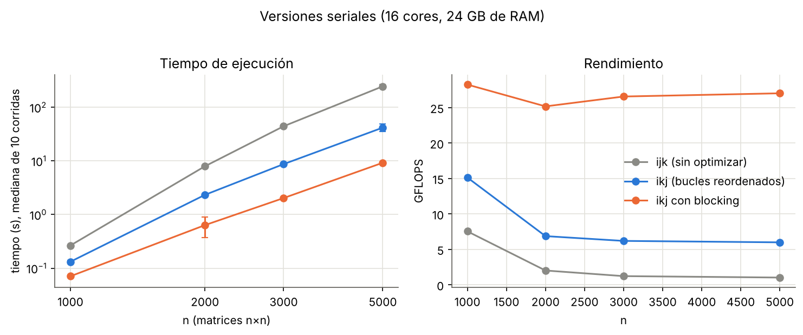
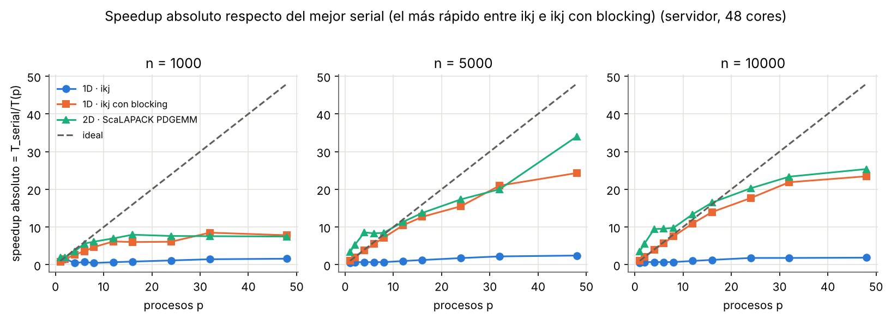
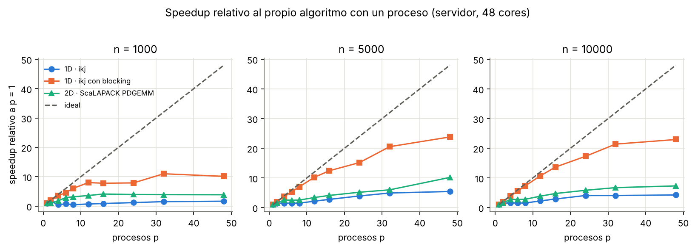
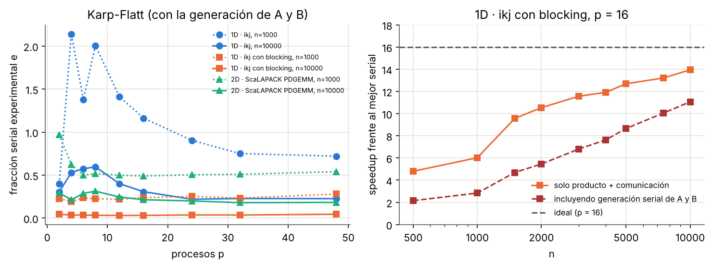
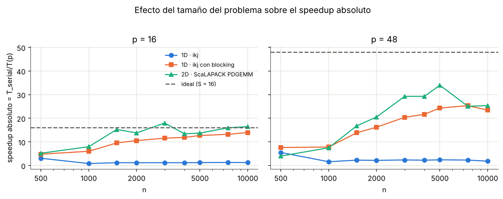
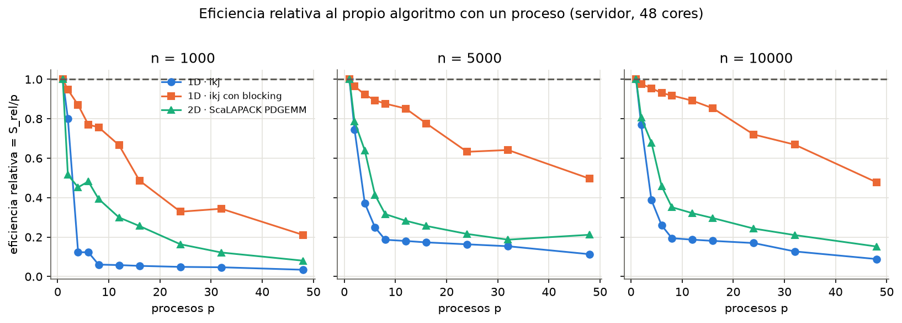
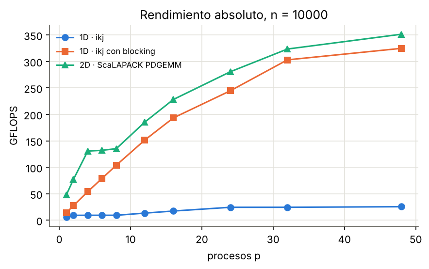
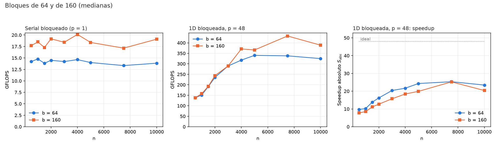
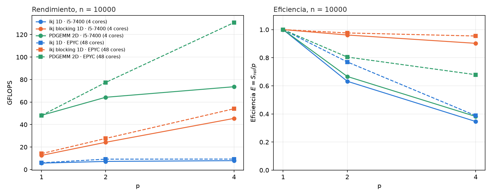

# Multiplicación de matrices en paralelo con MPI

**De la versión serial `ijk` a SUMMA y ScaLAPACK**

*Optimización de memoria, partición de datos y escalabilidad*

---

**Proyecto 8 — Métodos de Computación de Alto Rendimiento (HPC)**

**Autores:** Sofía Rodriguez del Busto · Gabriel Rojas · Pedro Ignacio Salinas

---

## Contenido

- [**1. El problema y su complejidad**](#1-el-problema-y-su-complejidad)  
  <small>Definición matemática del producto de matrices, complejidad computacional \(O(n^3)\), paralelismo inherente y desafíos de la comunicación en MPI.</small>
  - [1.1 Definición matemática](#11-definición-matemática)
  - [1.2 Complejidad del algoritmo](#12-complejidad-del-algoritmo)
  - [1.3 Un problema embarazosamente paralelo](#13-un-problema-embarazosamente-paralelo)
  - [1.4 ¿Por qué sigue siendo un campo de estudio en MPI?](#14-por-qué-entonces-es-un-campo-de-estudio-en-mpi)

- [**2. Implementaciones seriales**](#2-implementaciones-seriales)  
  <small>Optimización progresiva mediante reordenamiento de bucles, aprovechamiento de la caché y blocking (teselado), con ejemplos y resultados experimentales.</small>
  - [2.1 Versión `ijk`: la definición sin optimizar](#21-versión-ijk-la-definición-sin-optimizar)
  - [2.2 Primera mejora: reordenar los bucles (`ikj`)](#22-primera-mejora-reordenar-los-bucles-ikj)
  - [2.3 Segunda mejora: blocking (teselado)](#23-segunda-mejora-blocking-teselado)
    - Ejemplo numérico con bloques
    - Elección del tamaño de bloque
  - [2.4 Datos y entorno de la comparación](#24-datos-y-entorno-de-la-comparación)
  - [2.5 Resultados](#25-resultados)

- [**3. Paralelización con MPI**](#3-paralelización-con-mpi)  
  <small>Modelo de memoria distribuida, ejecución SPMD, comunicaciones colectivas y funciones MPI utilizadas en el proyecto.</small>
  - [3.1 Qué es MPI](#31-qué-es-mpi)
  - [3.2 Por qué MPI para este trabajo](#32-por-qué-mpi-para-este-trabajo)
  - [3.3 Conceptos básicos](#33-conceptos-básicos)
  - [3.4 Funciones principales](#34-funciones-principales)
  - [3.5 Esquema típico de un programa](#35-esquema-típico-de-un-programa)
  - [3.6 Costo de comunicar](#36-costo-de-comunicar)

- [**4. Partición unidimensional (1D)**](#4-partición-unidimensional-1d)  
  <small>Distribución por filas, implementación de los kernels seriales con MPI, equilibrio de carga, costos de comunicación y limitaciones de memoria.</small>
  - [4.1 Primera elección: dividir por filas](#41-primera-elección-dividir-por-filas)
  - [4.2 Funcionamiento](#42-funcionamiento)
  - [4.3 Aplicación a las versiones seriales anteriores](#43-aplicación-a-las-versiones-seriales-anteriores)
  - [4.4 Beneficios](#44-beneficios)
  - [4.5 Limitaciones](#45-limitaciones)

- [**5. Partición bidimensional y el algoritmo SUMMA**](#5-partición-bidimensional-y-el-algoritmo-summa)  
  <small>Distribución en una grilla de procesos 2D, comunicación por filas y columnas, ejemplo numérico paso a paso y alcance de la implementación propia.</small>
  - [5.1 La distribución 2D como solución a las limitaciones de la 1D](#51-la-distribución-2d-como-solución-a-las-limitaciones-de-la-1d)
  - [5.2 El algoritmo SUMMA](#52-el-algoritmo-summa)
    - Ejemplo paso a paso
  - [5.3 Alcance del proyecto: la implementación propia](#53-alcance-del-proyecto-la-implementación-propia)

- [**6. ScaLAPACK como referencia de la distribución 2D**](#6-scalapack-como-referencia-de-la-distribución-2d)  
  <small>Uso de `PDGEMM` como referencia, relación con SUMMA, optimizaciones de álgebra lineal y adaptación del orden de almacenamiento de las matrices.</small>
  - [6.1 Por qué ScaLAPACK](#61-por-qué-scalapack)
  - [6.2 Cada función de ScaLAPACK y el paso de SUMMA que realiza](#62-cada-función-de-scalapack-y-el-paso-de-summa-que-realiza)
  - [6.3 Qué ocurre dentro de `PDGEMM`](#63-qué-ocurre-dentro-de-pdgemm)
  - [6.4 Optimizaciones que incorpora](#64-optimizaciones-que-incorpora)
  - [6.5 El problema del orden en memoria y el artilugio matemático](#65-el-problema-del-orden-en-memoria-y-el-artilugio-matemático)

- [**7. Análisis de resultados**](#7-análisis-de-resultados)  
  <small>Evaluación experimental del rendimiento, speedup, eficiencia, ley de Amdahl, escalabilidad, distribución 1D frente a 2D y comparación entre equipos.</small>
  - [7.1 Diseño experimental y métricas](#71-diseño-experimental-y-métricas)
  - [7.2 Panorama general](#72-panorama-general)
  - [7.3 La ley de Amdahl y la fracción no paralelizable](#73-la-ley-de-amdahl-y-la-fracción-no-paralelizable)
    - Generación serial
    - Fracción serial experimental (Karp-Flatt)
    - Entrada desde archivo
    - Lectura paralela en MPI: mejora no realizada
  - [7.5 Por qué un \(n\) grande favorece el speedup](#75-por-qué-un-n-grande-favorece-el-speedup)
  - [7.6 Por qué la eficiencia cae con \(p\) grande](#76-por-qué-la-eficiencia-cae-con-p-grande)
  - [7.7 Partición 1D frente a 2D](#77-partición-1d-frente-a-2d)
  - [7.8 Limitaciones del estudio](#78-limitaciones-del-estudio)
  - [7.9 Conclusiones del análisis](#79-conclusiones-del-análisis)
  - [7.10 Efecto de un bloque mayor: \(b=160\) frente a \(b=64\)](#710-efecto-de-un-bloque-mayor-b-160-frente-a-b-64)
  - [7.11 Replicación en un segundo equipo (i5-7400)](#711-replicación-en-un-segundo-equipo-i5-7400)
  - [7.12 Memoria por proceso: 1D frente a 2D](#712-memoria-por-proceso-1d-frente-a-2d)

- [**8. Mejoras, líneas a evaluar y perspectivas**](#8-mejoras-líneas-a-evaluar-y-perspectivas)  
  <small>Propuestas de optimización derivadas de las mediciones, técnicas pendientes de evaluación y perspectivas de ejecución en clústeres y GPU.</small>
  - [8.1 Mejoras derivadas de los resultados](#81-mejoras-derivadas-de-los-resultados)
    - Generación y lectura distribuidas de las matrices
    - Otras mejoras relacionadas con los resultados
  - [8.2 Líneas a evaluar](#82-líneas-a-evaluar)
    - Solapamiento de comunicación y cómputo
    - Estrategias de paginación
    - Estrategias de distribución dinámica
  - [8.3 Perspectivas](#83-perspectivas)
    - Clústeres con nodos y GPU
    - Bibliotecas optimizadas: SLATE y NVIDIA cuBLASMp

- [**9. Bibliografía**](#9-bibliografía)  
  <small>Referencias sobre algoritmos paralelos, álgebra lineal de alto rendimiento, bibliotecas especializadas y MPI.</small>
  - [Algoritmos y teoría](#algoritmos-y-teoría)
  - [Álgebra lineal de alto rendimiento y bibliotecas](#álgebra-lineal-de-alto-rendimiento-y-bibliotecas)
  - [MPI](#mpi)

## Introducción

La multiplicación de matrices densas, $C = A \times B$, es una de las operaciones más estudiadas de la computación científica: tiene una definición elemental, un costo cúbico y una estructura de datos tan regular que casi cualquier estrategia de paralelización puede aplicarse y compararse con claridad. Este trabajo recorre el problema en tres etapas.

En la primera se estudian tres versiones **seriales** del algoritmo. La versión ingenua `ijk` recorre la segunda matriz por columnas y desaprovecha la memoria caché; reordenar los bucles (`ikj`) elimina ese defecto, y el *blocking* (bloqueado por teselas) hace que los datos en uso permanezcan en caché. En una máquina de 16 cores y 24 GB de RAM, la versión bloqueada resultó entre 3,7 y 26,6 veces más rápida que la ingenua según el tamaño del problema.

En la segunda etapa se paraleliza con **MPI** mediante una partición unidimensional (1D) por filas, implementada de forma propia sobre las tres versiones seriales. Se analizan sus beneficios (simplicidad, una sola difusión de *B*) y su limitación estructural: cada proceso debe almacenar una copia completa de *B*.

En la tercera etapa se presenta la **partición bidimensional (2D)** como solución a esa limitación, se explica el algoritmo **SUMMA** con un ejemplo numérico completo y se justifica por qué su implementación propia quedó fuera del alcance del proyecto. En su lugar se estudió y utilizó **ScaLAPACK** (`PDGEMM`), que lo emplea internamente, como referencia 2D.

El análisis de resultados, realizado en un equipo de 48 cores y 192 GB de RAM, confirma empíricamente los argumentos teóricos: la eficiencia cae al aumentar el número de procesos porque la comunicación y la contención de memoria no se reducen en la misma proporción que el cómputo (ley de Amdahl); y mejora al aumentar $n$ porque el cómputo crece como $O(n^3)$ mientras que la comunicación crece como $O(n^2)$. El informe cierra con mejoras posibles (generación y lectura distribuidas de las matrices, paginación, distribución dinámica, ejecución en clústeres y GPU) y con las bibliotecas que hoy dominan el área (SLATE, NVIDIA cuBLASMp).


## Entornos de medición

| | Serial (capítulo 2) | Paralelo (capítulos 4 a 7) | Replicación (sección 7.11) |
|---|---|---|---|
| Procesador | Intel Core Ultra 9 185H @ 2,5 GHz | AMD EPYC 7B12 | Intel Core i5-7400 @ 3,0 GHz (sin SMT) |
| Cores | 16 | 48 | 4 |
| RAM | 24 GB | 192 GB | 12 GB |
| Compilador y opciones | `gcc 15.2.0` (MSYS2), `-std=gnu11 -O3 -march=native` | `gcc 13.3.0`, `-std=gnu11 -O3 -march=native -mcmodel=medium` | `gcc 11.4.0`, mismas opciones |
| MPI y ejecución | no aplica | Open MPI 4.1.6; `mpirun --bind-to core --map-by core -np p`; `OPENBLAS_NUM_THREADS=1` | Open MPI 4.1.2; igual |
| Repeticiones por punto | 10 | 10 si $n \le 2000$, 5 si $n \gt  2000$ | igual |
| Estadístico | mediana (y desvío) | mediana (y desviación absoluta mediana) | igual |

Con cada equipo se hicieron dos corridas: una con las matrices generadas en memoria (todo el capítulo 7 salvo el apartado «Entrada desde archivo» de la sección 7.3) y otra leyéndolas de archivos de texto con la caché del sistema vacía (sección 7.3, apartado «Entrada desde archivo»). La segunda usa $p \in \{ 1, 2, 4, 8, 16, 32, 48\}$ en el EPYC y $p \in \{ 1, 2, 4\}$ en el i5-7400.

Los tamaños barridos en el equipo de 48 cores fueron $n \in \{ 500, 1000, 1500, 2000, 3000, 4000, 5000, 7500, 10000\}$ y $p \in \{ 1, 2, 4, 6, 8, 12, 16, 24, 32, 48\}$. En el i5-7400 se barrieron los mismos $n$ con $p \in \{ 1, 2, 4\}$. En todos los casos las matrices son cuadradas, de doble precisión (8 bytes por elemento) y generadas con semilla fija.

## Organización del repositorio

```
src/serial/     versiones seriales: ijk, ikj, ikj bloqueado
src/mpi/        versiones MPI con partición 1D: ijk, ikj, ikj bloqueado
src/ref/        referencia 2D con ScaLAPACK (PDGEMM)
src/common/     utilidades (matrices, partición, bloques, línea de comandos)
scripts/        benchmarks, cálculo de métricas y gráficos
resultados/     datos crudos (crudo.csv) y métricas (metricas.csv) de cada corrida
README.md       este informe
img/            imágenes del informe
```

Los gráficos de este informe se regeneran con `python scripts/graficos_informe.py` (desde la raíz del repositorio) a partir de los CSV de `resultados/`.

## Convenciones

- $n$ es la dimensión de las matrices cuadradas; $p$ es el número de procesos MPI.
- $T_{ser}$ es el tiempo de la mejor versión serial y $T(p)$ el de la versión paralela con $p$ procesos (siempre medianas).
- **Speedup relativo**: $S_{rel}(p) = T(1)/T(p)$. **Speedup absoluto**: $S_{abs}(p) = T_{ser}/T(p)$. **Eficiencia**: $E(p) = S(p)/p$.

---

## 1. El problema y su complejidad


### 1.1 Definición matemática

Dadas dos matrices densas $A \in \mathbb{R}^{n \times m}$ y $B \in \mathbb{R}^{m \times p}$, su producto es la matriz $C \in \mathbb{R}^{n \times p}$ cuyo elemento en la fila $i$ y la columna $j$ es el producto escalar de la fila $i$ de *A* por la columna $j$ de *B*:

$$
C_{ij} = \sum_{k=0}^{m-1} A_{ik} \cdot B_{kj}, \qquad 0 \le i < n, 0 \le j < p
$$

La operación solo está definida si el número de columnas de *A* coincide con el número de filas de *B*. En este trabajo se usan casi siempre matrices cuadradas ( $n = m = p$ ), lo que simplifica el análisis sin perder generalidad: el código admite dimensiones distintas.

Un ejemplo pequeño fija la idea. Con las matrices de $4 \times 4$ que se usarán a lo largo del informe,

$$
A = \begin{pmatrix}
1 & 2 & 3 & 4 \\
5 & 6 & 7 & 8 \\
9 & 10 & 11 & 12 \\
13 & 14 & 15 & 16 \\
\end{pmatrix}
\qquad
B = \begin{pmatrix}
1 & 2 & 3 & 1 \\
3 & 1 & 2 & 3 \\
2 & 1 & 1 & 2 \\
1 & 3 & 2 & 1 \\
\end{pmatrix}
$$

el elemento $C_{00}$ es la fila 0 de *A* por la columna 0 de *B*:

$$
C_{00} = 1 \cdot 1 + 2 \cdot 3 + 3 \cdot 2 + 4 \cdot 1 = 17
$$

y el producto completo es

$$
C = A \cdot B = \begin{pmatrix}
17 & 19 & 18 & 17 \\
45 & 47 & 50 & 45 \\
73 & 75 & 82 & 73 \\
101 & 103 & 114 & 101 \\
\end{pmatrix}
$$

Estas mismas matrices se reutilizan en los capítulos 2 (blocking) y 5 (SUMMA), de modo que el lector puede comprobar que todas las estrategias llegan al mismo resultado.

### 1.2 Complejidad del algoritmo

El algoritmo directo calcula $n \cdot p$ elementos y, para cada uno, realiza $m$ multiplicaciones y $m$ sumas. En el caso cuadrado:

| Magnitud | Valor | Orden |
|---|---|---|
| Operaciones de punto flotante | $2n^3$ | $O(n^3)$ |
| Datos de entrada y salida | $3n^2$ elementos | $O(n^2)$ |
| Operaciones por dato (intensidad aritmética) | $\approx 2n/3$ | $O(n)$ |

Hay dos consecuencias prácticas. La primera es que el tiempo crece muy rápido: duplicar $n$ multiplica por ocho el trabajo. Con $n = 10\,000$ son $2 \times 10^{12}$ operaciones, es decir, más de cinco minutos con un único núcleo a unos 6 GFLOPS (así sucedió en las mediciones, ver capítulo 7). La segunda es más sutil y es la clave de todo el informe: **el cómputo crece más rápido que los datos**. Cada elemento de *A* y de *B* participa en $n$ productos, de manera que existe, en principio, mucha oportunidad de reutilizar un dato ya traído a la memoria rápida. Aprovechar o desperdiciar esa reutilización es lo que separa a las implementaciones seriales del capítulo 2, y la relación entre cómputo y comunicación es lo que determina la escalabilidad paralela del capítulo 7.

Existen algoritmos asintóticamente mejores. El de Strassen (1969) reduce el exponente a $\log_2 7 \approx 2{,}807$ a costa de más sumas, mayor uso de memoria y menor estabilidad numérica; en la práctica las bibliotecas de alto rendimiento siguen usando el algoritmo clásico de $O(n^3)$ con una implementación extremadamente cuidadosa, que es el enfoque de este trabajo.

### 1.3 Un problema *embarazosamente paralelo*

Se llama **embarazosamente paralelo** (*embarrassingly parallel*) a un problema que puede dividirse en tareas independientes que no necesitan comunicarse entre sí durante el cálculo. La multiplicación de matrices cumple esa condición en su núcleo: la fórmula de $C_{ij}$ solo lee una fila de *A* y una columna de *B* y no depende de ningún otro elemento de *C*. Por lo tanto, los $n^2$ elementos de *C* pueden calcularse en cualquier orden, o simultáneamente, sin sincronización.

Dicho de otro modo, si todos los procesos tuvieran todos los datos desde el inicio, el trabajo se repartiría de forma casi perfecta:

$$
T(p) \approx \frac{2n^3}{p \cdot R} \qquad S(p) \approx p
$$

donde $R$ es la velocidad de cómputo de un proceso (en FLOPS). El reparto, además, es naturalmente equilibrado: todas las filas de *C* cuestan lo mismo.

### 1.4 ¿Por qué entonces es un campo de estudio en MPI?

Porque la independencia matemática de las tareas no implica independencia de los *datos*. En un sistema de memoria distribuida (que es el modelo de MPI) cada proceso tiene su propia memoria y solo ve lo que se le envía. Para calcular su porción de *C*, un proceso necesita porciones de *A* y de *B* que inicialmente pueden estar en otra parte. Aparecen así tres problemas que no existen en la versión serial:

1. **Qué datos recibe cada proceso** (la *partición*). Un reparto ingenuo obliga a replicar una matriz entera en todos los procesos, lo que consume memoria (la llamada *memory wall*) y ancho de banda.
2. **Cuánto se comunica y cómo.** Enviar datos cuesta tiempo, y ese tiempo no disminuye al agregar procesos con la misma rapidez que el cómputo. Es la *fracción no paralelizable* de la ley de Amdahl, que se estudia en el capítulo 7.
3. **Cómo aprovechar la jerarquía de memoria local** de cada proceso, porque el rendimiento por núcleo depende tanto de la caché como de las unidades de cálculo.

Estas tensiones convirtieron a la multiplicación de matrices en el problema de referencia para comparar estrategias de descomposición de dominio —por filas, por bloques, en grilla 2D— y generaron algoritmos específicos (Cannon, 1969; SUMMA, 1997; versiones que evitan comunicación, 2011) y bibliotecas enteras (ScaLAPACK, SLATE, cuBLASMp). La estructura de este informe sigue precisamente ese camino: primero se resuelve bien el problema en un solo proceso, luego se reparte por filas, y finalmente se reparte en dos dimensiones.


---

## 2. Implementaciones seriales


Antes de repartir el trabajo entre procesos conviene resolver bien el problema en uno solo. Hay una razón práctica y otra metodológica. La práctica es que un kernel serial lento oculta los problemas de la paralelización (se obtiene un excelente *speedup* sobre una base mala). La metodológica es que el speedup solo es significativo si se mide contra la mejor versión serial disponible, no contra la más ingenua.

Las tres versiones comparten el mismo algoritmo, con el mismo número de operaciones, $2n^3$. Lo único que cambia es **el orden en que se recorren los datos**, y eso alcanza para variar el tiempo de ejecución en más de un orden de magnitud. Las tres se encuentran en `src/serial/`.

### 2.1 Versión ijk: la definición sin optimizar

La traducción directa de la fórmula $C_{ij} = \sum_k A_{ik} \cdot B_{kj}$ es el triple bucle clásico:

```c
for (int i = 0; i < n; i++)
    for (int j = 0; j < p; j++) {
        real_t acumulador = 0.0;
        for (int k = 0; k < m; k++)
            acumulador += a[i*m + k] * b[k*p + j];
        c[i*p + j] = acumulador;
    }
```

Es correcta y es la que aparece en cualquier libro, pero tiene un problema de fondo que depende del lenguaje.

#### La limitación: C guarda las matrices por filas

C almacena las matrices bidimensionales en orden **row-major**: los elementos de una fila ocupan posiciones consecutivas de memoria, y la posición del elemento $(i, j)$ es `i*columnas + j`. Una fila es, entonces, un tramo contiguo; una columna, en cambio, está dispersa, con un salto de `columnas` elementos entre un elemento y el siguiente.

El bucle más interno de `ijk` varía $k$. Con ello:

- `a[i*m + k]` recorre la fila $i$ de *A*: acceso **contiguo** (paso 1).
- `b[k*p + j]` recorre la columna $j$ de *B*: acceso **con salto** de $p$ elementos. Para $n = 5000$ son $5000 \times 8 = 40\,000$ bytes entre un acceso y el siguiente.

La memoria no se trae elemento por elemento sino en **líneas de caché**, que en los procesadores usados aquí (x86-64) son de 64 bytes, es decir, 8 números de doble precisión. Cuando se lee un elemento, llegan también sus siete vecinos de la misma fila. El tamaño de línea depende de la arquitectura (hay procesadores con líneas de 32 o 128 bytes), pero el argumento no cambia: con otro tamaño solo varía cuántos vecinos se traen y se desperdician. En `ijk` esos vecinos pertenecen a otras columnas de *B*, que no se usarán hasta una iteración posterior del bucle $j$; para entonces, la línea de caché probablemente ya fue desalojada, porque entre medio se recorrieron las $n$ filas de *B*. El resultado es que casi cada acceso a *B* trae de memoria una línea completa para aprovechar un solo elemento: **no se aprovecha la localidad espacial**. Además, un acceso con saltos grandes y regulares es mucho más difícil de anticipar para el prefetcher del procesador que uno contiguo.

El efecto se hace visible en cuanto *B* deja de entrar en las cachés. Con $n = 1000$, *B* ocupa 8 MB y `ijk` alcanza 7,5 GFLOPS; con $n = 5000$ ocupa 200 MB y el rendimiento cae a 1,0 GFLOPS (sección 2.5).

### 2.2 Primera mejora: reordenar los bucles (ikj)

Como la suma sobre $k$ puede hacerse en cualquier orden, es posible intercambiar los bucles. En el orden `ikj` se fijan $i$ y $k$, y el bucle más interno barre $j$:

```c
for (int i = 0; i < n; i++)
    for (int k = 0; k < m; k++) {
        const real_t a_ik = a[i*m + k];          // escalar, fuera del bucle interno
        for (int j = 0; j < p; j++)
            c[i*p + j] += a_ik * b[k*p + j];
    }
```

Ahora las dos matrices que se recorren en el bucle interno —la fila $k$ de *B* y la fila $i$ de *C*— se leen con **paso 1**. Esto trae tres beneficios, todos consecuencia de la contigüidad:

1. **Localidad espacial.** Cada línea de caché se usa por completo: los ocho elementos que llegan juntos se consumen en ocho iteraciones consecutivas.
2. **Prefetching.** El acceso secuencial es el patrón que el hardware predice mejor y trae con anticipación.
3. **Vectorización.** Como `a_ik` es constante en el bucle interno y los accesos son contiguos y sin solapamiento (`restrict`), el compilador puede emplear instrucciones SIMD (AVX/FMA) que procesan varios elementos por instrucción.

La complejidad no cambia; solo se reduce la constante oculta, que en la práctica es un factor entre 2 y 6 (sección 2.5).

#### Lo que ikj todavía no resuelve

Para cada fila $i$ de *A*, el bucle $k$ recorre **todas** las filas de *B*. Si *B* no cabe en caché, se vuelve a traer completa desde la memoria principal en cada una de las $n$ iteraciones de $i$: *B* viaja $n$ veces. Con $n = 5000$ esto significa $n \cdot 200\ \text{MB} = 1\ \text{TB}$ de lectura de memoria para un cálculo que, en rigor, solo necesita datos por 600 MB. En el gráfico de la sección 2.5 se ve el efecto: `ikj` rinde 15 GFLOPS mientras *B* entra en caché ( $n = 1000$ ) y se estabiliza en torno a 6 GFLOPS cuando ya no entra. El programa pasó a estar limitado por el ancho de banda de memoria, no por el cálculo.

### 2.3 Segunda mejora: blocking (teselado)

La idea del *blocking* es operar sobre submatrices ("bloques" o "teselas") lo bastante pequeñas como para que los bloques activos —uno de *A*, uno de *B* y uno de *C*— se reutilicen intensamente desde la caché antes de ser desalojados (qué tamaño es el mejor depende de la máquina; ver la elección del tamaño más abajo). En lugar de recorrer cada dimensión de punta a punta, se la recorre de a $b$ elementos:

```c
for (int ii = 0; ii < n; ii += b)          // bloque de filas de C y A
  for (int jj = 0; jj < p; jj += b)        // bloque de columnas de C y B
    for (int kk = 0; kk < m; kk += b)      // bloque de la dimensión compartida
      // el mismo cuerpo ikj, acotado a los rangos del bloque
      for (int i = ii; i < min(ii+b, n); i++)
        for (int k = kk; k < min(kk+b, m); k++) {
          const real_t a_ik = a[i*m + k];
          for (int j = jj; j < min(jj+b, p); j++)
            c[i*p + j] += a_ik * b[k*p + j];
        }
```

El orden de los bucles externos (`ii`, `jj`, `kk`) es deliberado: para un bloque de *C* fijo se recorren todos los valores de `kk` antes de pasar al siguiente, de modo que el bloque de *C* permanece en caché mientras acumula los aportes de cada par de bloques $A_{ik} \cdot B_{kj}$.

#### Ejemplo numérico con una matriz pequeña

Se usan las matrices de $4 \times 4$ del capítulo 1 con bloques de $2 \times 2$ ( $b = 2$ ). Cada matriz queda dividida en cuatro bloques:

$$
A = \begin{pmatrix}
A_{00} & A_{01} \\
A_{10} & A_{11} \\
\end{pmatrix}\quad
B = \begin{pmatrix}
B_{00} & B_{01} \\
B_{10} & B_{11} \\
\end{pmatrix}\quad
C = \begin{pmatrix}
C_{00} & C_{01} \\
C_{10} & C_{11} \\
\end{pmatrix}
$$

con

$$
A_{00}=\begin{pmatrix}
1 & 2 \\
5 & 6 \\
\end{pmatrix}
A_{01}=\begin{pmatrix}
3 & 4 \\
7 & 8 \\
\end{pmatrix}
B_{00}=\begin{pmatrix}
1 & 2 \\
3 & 1 \\
\end{pmatrix}
B_{10}=\begin{pmatrix}
2 & 1 \\
1 & 3 \\
\end{pmatrix}
$$

El producto por bloques sigue la misma regla que el producto de matrices de $2\times 2$, pero con bloques en lugar de números:

$$
C_{ij} = \sum_{k} A_{ik} \cdot B_{kj}
$$

Para el bloque $C_{00}$ el algoritmo hace dos pasos (`kk = 0` y `kk = 2`), manteniendo $C_{00}$ en caché:

| Paso | Bloques que se cargan en caché | Operación |
|---|---|---|
| 0 | $A_{00}$, $B_{00}$, $C_{00}$ (12 números) | $C_{00} \mathrel{+}= A_{00} \cdot B_{00}$ |
| 1 | $A_{01}$, $B_{10}$ (y $C_{00}$ ya presente) | $C_{00} \mathrel{+}= A_{01} \cdot B_{10}$ |

Con los valores numéricos, el paso 0 deja en $C_{00}$

$$
C_{00} = A_{00} \cdot B_{00} = \begin{pmatrix}
7 & 4 \\
23 & 16 \\
\end{pmatrix}
$$

y el paso 1 suma

$$
A_{01} \cdot B_{10} = \begin{pmatrix}
10 & 15 \\
22 & 31 \\
\end{pmatrix}
\quad\Longrightarrow\quad
C_{00} = \begin{pmatrix}
17 & 19 \\
45 & 47 \\
\end{pmatrix}
$$

El resultado, $C_{00}$, coincide con la esquina superior izquierda de *C* calculada en el capítulo 1. Repetido para los cuatro bloques de *C* son $(n/b)^3 = 8$ productos de bloques, cada uno trabajando únicamente sobre $3 \times 4 = 12$ números, que es lo que debe caber en caché en cada momento. La corrección del kernel bloqueado se verificó con una matriz conocida de $4 \times 4$ ( $A$ con los enteros 1 a 16 por filas y $B$ con los enteros 16 a 1; `scripts/test_matriz_conocida.sh`), con $b = 2$, con $b = 3$ (que no divide a 4, así que el último bloque es de un solo elemento) y con tamaños distintos por dimensión ( $b_i = 2$, $b_k = 3$, $b_j = 1$ ), tanto en la versión serial como en la MPI. Con el $b = 64$ por defecto la matriz cabe en un solo bloque y esa prueba no ejercita la partición. El mismo script (`scripts/test_matriz_conocida.sh`) repite la verificación con dos matrices rectangulares guardadas en `tests/datos/` junto con su producto $C$ ($5 \times 3$ por $3 \times 7$, con bloques que no dividen a ninguna dimensión, y $2 \times 6$ por $6 \times 3$, con más procesos que filas), de modo que cubre dimensiones $N$, $M$ y $P$ distintas en las versiones seriales, MPI 1D y la referencia ScaLAPACK.

**Por qué reduce el tráfico de memoria.** Con un modelo simplificado en el que un bloque que cabe en caché se carga una sola vez, cada bloque de *B* se trae $n/b$ veces (una por cada bloque de filas de *A*) en lugar de $n$ veces. En el ejemplo, *B* se lee 2 veces en lugar de 4; en general, el tráfico de *B* desde memoria principal se divide por el tamaño del bloque $b$. Cuanto mayor sea $b$, mayor es la reutilización, hasta el límite impuesto por la capacidad de la caché.

#### Elección del tamaño de bloque

El proyecto usa por defecto $b = 64$ (un bloque de *B* de $64 \times 64$ doubles, 32 KiB), con $b_i = b_k = b_j$. Es un parámetro de compilación (`-DBI`, `-DBK`, `-DBJ`, o `-DBLOQUE` para los tres; ver `src/common/bloque.h`). Una primera versión lo derivaba de la caché L2 de la máquina (los tres bloques activos en la mitad de la L2), pero se abandonó: un barrido de $b$ en dos máquinas distintas mostró que el óptimo depende de la jerarquía de caché de cada una y que una fórmula basada en la L2 no sirve en ambas.

**Barrido de $b$.** Se midió la versión serial bloqueada con `scripts/barrido_bloque.sh` (5 repeticiones por punto, GFLOPS medios), en dos máquinas:

- **Servidor:** AMD EPYC 7B12, L1d de 32 KiB y L2 de 512 KiB por core, con $n \in \{ 2000, 4000, 7500\}$ (`resultados/servidor/barrido_bloque.csv`).
- **Portátil:** Intel Core Ultra 9 185H (núcleos P con L1d de 48 KiB y L2 de 2 MiB), con $n \in \{ 1000, 2000, 4000\}$ (`resultados/local/barrido_bloque.csv`).

Servidor:

| $b$ | $n=2000$ | $n=4000$ | $n=7500$ |
|---:|---:|---:|---:|
| 32 | 11,83 | 14,10 | 11,90 |
| 64 | 14,35 | 14,80 | 13,40 |
| 104 | 15,23 | 15,34 | 14,76 |
| 128 | 15,85 | 15,94 | 15,22 |
| 144 | 16,31 | 16,18 | 15,35 |
| 160 | 16,35 | 19,29 | 15,72 |
| 176 | 16,36 | 16,31 | 15,74 |
| 192 | 16,54 | 16,42 | 15,83 |
| 256 | 13,72 | 13,53 | 12,69 |

Portátil:

| $b$ | $n=1000$ | $n=2000$ | $n=4000$ |
|---:|---:|---:|---:|
| 32 | 25,05 | 20,93 | 22,70 |
| 64 | 29,16 | 27,96 | 27,66 |
| 96 | 25,05 | 23,21 | 23,04 |
| 128 | 24,98 | 22,93 | 23,90 |
| 160 | 23,89 | 22,88 | 28,74 |
| 192 | 20,20 | 19,48 | 20,32 |
| 256 | 21,06 | 20,45 | 21,93 |

Lo que muestran los datos:

- **El tamaño de bloque importa en las dos máquinas.** La diferencia entre el peor y el mejor $b$ es de hasta un 33 % en el servidor (con $n=7500$, de 11,90 a 15,83 GFLOPS) y de hasta un 31 % en el portátil (con $n=1000$, de 20,20 a 29,16).
- **El óptimo es distinto en cada máquina.** En el servidor hay una meseta entre $b=144$ y $b=192$, con diferencias menores al 1,5 % entre puntos vecinos, que mejora entre un 10 % y un 18 % sobre $b=64$. En el portátil el máximo está en $b=64$ para los tres $n$, y $b \ge 192$ pierde entre un 25 % y un 30 %.
- **Los extremos no son buenos en ninguna:** $b=32$ reutiliza poco cada bloque, y $b=256$ cae en las dos máquinas.
- **Una fórmula basada en la L2 no sirve para las dos.** Con una L2 de 512 KiB (servidor) el óptimo cae cerca del 40 % de la L2 para el bloque de *B*; con los 2 MiB de L2 de un núcleo P del portátil, esa misma regla daría $b \approx 320$, peor que 64. Una regla basada en la L1d (32 KiB del bloque de *B* de $b=64$ entran en los 48 KiB del portátil) acierta en el portátil pero daría $b \approx 48$ en el servidor, por debajo de su meseta. Por eso se dejó $b=64$ fijo, que además es el valor con el que se midieron todos los benchmarks del informe.

Limitaciones que hay que tener presentes:

- **Anomalía en $n=4000$, $b=160$.** En el servidor da 19,3 GFLOPS, un 18-19 % por encima de $b=144$ y $b=176$, reproducida en cinco mediciones, la última con 10 repeticiones; en el portátil da 28,7, un 20 % por encima de $b=128$, mientras que con $n=1000$ y $n=2000$ no aparece. Que se repita en dos CPU distintas indica que depende de la combinación $n=4000$, $b=160$ y no del hardware, pero no se identificó el mecanismo. Como el serial bloqueado es la base del speedup de la versión MPI, un $b=160$ **inflaría el speedup en $n=4000$**; con $b=64$ no ocurre. En la medición más reciente, $n=2000$ y $n=7500$ dieron 16,2 y 15,6 GFLOPS con $b=160$, es decir, el valor alto aparece solo con $n=4000$.
- **Dos máquinas, un solo proceso.** Los barridos son de la versión serial; no se midió con varios procesos MPI compartiendo L3. El portátil tiene núcleos P y E, y el sistema operativo puede mover el proceso entre ellos, lo que agrega ruido a esas mediciones.
- **El servidor podría rendir hasta ~10 % más** usando un $b$ de la meseta (por ejemplo `-DBLOQUE=160` o `192`). Es un ajuste posible, no incluido en los resultados del informe; además, con $b=160$ el rendimiento varió entre sesiones (sección 7.10).

### 2.4 Datos y entorno de la comparación

Las tres versiones se midieron en una máquina de **16 cores y 24 GB de RAM**, para $n \in \{ 1000, 2000, 3000, 5000\}$, con 10 repeticiones por punto. Se informa la mediana, que es robusta frente a interferencias esporádicas del sistema operativo, junto con el desvío estándar. El rendimiento se calcula como $2n^3 / T$ y se expresa en GFLOPS (miles de millones de operaciones de punto flotante por segundo).

### 2.5 Resultados



*Figura 2.1. Tiempo (izquierda, escala logarítmica en ambos ejes) y rendimiento (derecha) de las tres versiones seriales. Las barras de error muestran el desvío estándar de 10 corridas*.

| $n$ | `ijk` (s) | `ikj` (s) | `ikj` bloqueado (s) | `ijk` / `ikj` | `ikj` / bloqueado | `ijk` / bloqueado |
|--:|--:|--:|--:|--:|--:|--:|
| 1000 | 0,265 | 0,132 | 0,071 | 2,0 | 1,9 | 3,7 |
| 2000 | 7,955 | 2,332 | 0,636 | 3,4 | 3,7 | 12,5 |
| 3000 | 44,32 | 8,727 | 2,033 | 5,1 | 4,3 | 21,8 |
| 5000 | 245,8 | 41,79 | 9,254 | 5,9 | 4,5 | 26,6 |

| $n$ | `ijk` (GFLOPS) | `ikj` (GFLOPS) | `ikj` bloqueado (GFLOPS) |
|--:|--:|--:|--:|
| 1000 | 7,5 | 15,1 | 28,2 |
| 2000 | 2,0 | 6,9 | 25,2 |
| 3000 | 1,2 | 6,2 | 26,6 |
| 5000 | 1,0 | 6,0 | 27,0 |

Se observan tres hechos que confirman la discusión anterior.

1. **El reordenamiento de bucles ya es una mejora considerable** y crece con $n$ (de 2,0 a 5,9 veces), porque a mayor tamaño más se castiga el acceso por columnas.
2. **`ikj` pierde la mitad de su rendimiento al pasar de $n = 1000$ a $n = 2000$** y luego se estabiliza: es el momento en que *B* deja de caber en las cachés y el programa queda limitado por la memoria.
3. **El blocking mantiene el rendimiento prácticamente constante** (entre 25 y 28 GFLOPS) a cualquier tamaño, porque el conjunto de trabajo en caché depende de $b$ y no de $n$. La ganancia sobre `ikj` llega a 4,5 veces y sobre `ijk` a 26,6 veces en $n = 5000$.

Una observación metodológica: en $n = 2000$ la versión bloqueada muestra un desvío grande (barra de error en la figura), señal de interferencia en alguna de las corridas; por eso se usa la mediana y no el promedio.

**Conclusión del capítulo.** La versión `ikj` con blocking es la base serial contra la que se mide el speedup en el resto del trabajo (en el servidor, con $n \le 1000$ el `ikj` sin blocking es algo más rápido y es la base en esos casos; ver sección 7.1), y es también el kernel local de la versión paralela más eficiente (capítulo 4). Aun así, está lejos de lo que logran las bibliotecas especializadas, que combinan blocking en varios niveles de caché con empaquetado de datos, microkernels en ensamblador y vectorización; esas técnicas se describen en el capítulo 6 a propósito de OpenBLAS, que es el motor de cálculo local de ScaLAPACK.


---

## 3. Paralelización con MPI

### 3.1 Qué es MPI

**MPI** (*Message Passing Interface*) es el estándar de facto para programar sistemas de **memoria distribuida**. No es una biblioteca concreta sino una especificación, mantenida por el MPI Forum, que implementan Open MPI, MPICH y las versiones de cada fabricante. Un programa MPI consiste en varios **procesos independientes**, cada uno con su propio espacio de memoria; no existen variables compartidas, y todo intercambio de datos debe hacerse mediante **mensajes** explícitos.

El modelo de ejecución es **SPMD** (*Single Program, Multiple Data*): se lanza el mismo ejecutable en $p$ procesos (`mpirun -np p ./programa`) y cada uno se distingue de los demás por su **rank**, un número entre $0$ y $p-1$. Es el programador quien decide, según el rank, qué parte de los datos le toca a cada uno y cuándo se comunican.

### 3.2 Por qué MPI para este trabajo

- **Es el modelo de los clústeres.** Un clúster es un conjunto de nodos con memoria propia conectados por una red; MPI es la forma estándar de programarlos. Un código MPI funciona igual en una PC, en un servidor de muchos cores o en cientos de nodos, cambiando solamente el número de procesos.
- **Obliga a pensar la partición de datos.** Con memoria compartida (OpenMP) el reparto del trabajo es casi trivial, porque todos los hilos ven las mismas matrices. Con MPI hay que decidir qué porción de *A*, *B* y *C* vive en cada proceso y qué hay que enviar, que es precisamente el objeto de estudio de este informe.
- **Es la base de las bibliotecas de álgebra lineal distribuida** (ScaLAPACK usa MPI a través de BLACS; SLATE también), por lo que lo aprendido se aplica directamente a ellas.

Aunque OpenBLAS puede paralelizar la multiplicación por sí mismo con hilos, para que la comparación sea objetiva y centrada en la distribución de datos, toda la paralelización de este trabajo se hace con procesos MPI (con un hilo de OpenBLAS por proceso, fijado con `OPENBLAS_NUM_THREADS=1`, de modo que $p$ procesos usan exactamente $p$ cores).

### 3.3 Conceptos básicos

| Concepto | Significado |
|---|---|
| **Comunicador** | Grupo de procesos que pueden comunicarse entre sí. `MPI_COMM_WORLD` contiene a todos. |
| **Rank y tamaño** | Identificador de un proceso dentro de un comunicador, y número total de procesos del mismo. |
| **Comunicación punto a punto** | Un proceso envía y otro recibe (`MPI_Send` / `MPI_Recv`). |
| **Comunicación colectiva** | Participan todos los procesos de un comunicador (difusión, reparto, recolección, reducción). Las implementaciones las optimizan con algoritmos en árbol. |
| **Bloqueante / no bloqueante** | Una llamada bloqueante no retorna hasta que el buffer es reutilizable; las no bloqueantes (`MPI_Isend`, `MPI_Irecv`) retornan de inmediato y permiten solapar comunicación con cómputo. |
| **Tipo de dato derivado** | Descripción de una región de memoria no contigua (por ejemplo, un bloque rectangular de una matriz) para enviarla en un solo mensaje. |

### 3.4 Funciones principales

Las funciones se agrupan por su papel. La columna final indica dónde se usan en el código del proyecto.

| Función | Qué hace | Uso en el proyecto |
|---|---|---|
| `MPI_Init` / `MPI_Finalize` | Inician y cierran el entorno MPI. Todo programa debe llamarlas. | Todas las versiones MPI. |
| `MPI_Comm_size` | Cantidad $p$ de procesos del comunicador. | Cálculo de la partición. |
| `MPI_Comm_rank` | Rank del proceso que llama. | Elegir qué filas procesa cada uno; el rank 0 genera y recolecta. |
| `MPI_Send` / `MPI_Recv` | Envío y recepción punto a punto, bloqueantes. | Base conceptual de la comunicación punto a punto; no se usan en el núcleo de las versiones 1D. |
| `MPI_Bcast` | El proceso raíz envía el mismo dato a todos. | Difusión de *B* completa en la versión 1D; difusión de paneles por filas y columnas en SUMMA. |
| `MPI_Scatterv` | La raíz reparte porciones **de distinto tamaño** de un arreglo, una a cada proceso. | Reparto de filas de *A* (cuando $n$ no es múltiplo de $p$ ). |
| `MPI_Gatherv` | Inverso de `Scatterv`: la raíz recolecta porciones de distinto tamaño. | Reconstrucción de *C* en el rank 0. |
| `MPI_Reduce` | Combina un valor de cada proceso con una operación (suma, máximo…) en la raíz. | Solo en la referencia `PDGEMM`: obtener el **máximo** de los tiempos locales de cada fase (el tiempo de una ejecución paralela es el del proceso más lento). Las versiones 1D cronometran en el rank 0. |
| `MPI_Barrier` | Sincroniza: nadie continúa hasta que todos llegan. | Alinear a todos los procesos antes de empezar a cronometrar. |
| `MPI_Wtime` | Tiempo de reloj de pared en segundos. | Todas las mediciones de las versiones MPI. Las versiones seriales usan `clock_gettime(CLOCK_MONOTONIC)` (`src/common/timing.h`), que también mide reloj de pared. |
| `MPI_Abort` | Termina todos los procesos ante un error. | Error al leer los archivos de entrada, error al calcular las particiones y número de procesos mayor que `MAX_PROCESOS`. Con argumentos de línea de comandos inválidos no se aborta: cada proceso imprime el uso y termina con `MPI_Finalize`. |

### 3.5 Esquema típico de un programa

```c
MPI_Init(&argc, &argv);
MPI_Comm_rank(MPI_COMM_WORLD, &rank);
MPI_Comm_size(MPI_COMM_WORLD, &size);

if (rank == 0) generar_matrices(A, B);        // solo la raíz tiene los datos completos

MPI_Barrier(MPI_COMM_WORLD);
double t0 = MPI_Wtime();
MPI_Bcast(B, ...);                             // comunicación
MPI_Scatterv(A, ..., local_A, ...);            // comunicación
multiplicar(local_A, B, local_C, ...);         // cómputo local
MPI_Gatherv(local_C, ..., C, ...);             // comunicación
double t1 = MPI_Wtime();

MPI_Finalize();
```

### 3.6 Costo de comunicar

Un modelo habitual para el costo de enviar un mensaje de $s$ bytes es

$$
T_{msg} = \alpha + \beta \cdot s
$$

donde $\alpha$ es la **latencia** (costo fijo por mensaje) y $\beta$ el inverso del **ancho de banda** (costo por byte). Una difusión a $p$ procesos implementada en árbol cuesta del orden de $\log_2 p$ pasos de ese tipo. Dos consecuencias importan para este trabajo: (i) el costo crece con el volumen de datos enviado, de modo que **cuántos datos recibe cada proceso** es la magnitud crítica de cualquier estrategia de partición; y (ii) ese costo no se divide entre los procesos como sí se divide el cómputo, lo que explica la pérdida de eficiencia que se mide en el capítulo 7.

Una precaución al interpretar las mediciones: en este trabajo todos los procesos corren en **un único equipo**. Allí MPI comunica mediante memoria compartida del sistema operativo, sin pasar por una red física. Los resultados reflejan por lo tanto el costo de copiar datos y de competir por el ancho de banda de memoria, y subestiman el costo que tendría la misma comunicación en un clúster real (ver capítulo 8).


---

## 4. Partición unidimensional (1D)

### 4.1 Primera elección: dividir por filas

Entre las estrategias posibles de reparto, la más natural es la **partición 1D por filas**: se divide *A* en $p$ bloques horizontales de filas consecutivas y se entrega uno a cada proceso. Como la fila $i$ de *C* depende únicamente de la fila $i$ de *A* y de **toda** la matriz *B*, cada proceso puede calcular su bloque de filas de *C* sin intervención de los demás, siempre que disponga de su bloque de *A* y de *B* completa:

```
        A (reparto por filas)        B (copia completa en todos)      C (filas calculadas por cada uno)

     P0 │ filas 0 … n/p-1   │                                        P0 │ filas 0 … n/p-1   │
     P1 │ filas n/p … 2n/p-1│          B se envía entera             P1 │ filas n/p … 2n/p-1│
     P2 │ …                 │          a P0, P1, P2, …               P2 │ …                 │
     P3 │ …                 │                                        P3 │ …                 │
```

Es la estrategia que se implementó de forma propia, tanto por su simplicidad como porque deja visible la relación entre reparto de datos y rendimiento, que es lo que este trabajo busca estudiar.

### 4.2 Funcionamiento

El algoritmo consta de cinco etapas, todas con comunicaciones colectivas (código en `src/mpi/`):

1. **Generación (rank 0).** El proceso 0 crea *A* y *B* completas con una semilla fija.
2. **Difusión de <i>B</i>** a todos los procesos: `MPI_Bcast`.
3. **Reparto de <i>A</i>** por bloques de filas: `MPI_Scatterv`.
4. **Cómputo local.** Cada proceso multiplica su bloque de filas de *A* por *B* y obtiene su bloque de filas de *C*.
5. **Recolección de <i>C</i>** en el rank 0: `MPI_Gatherv`.

El núcleo cronometrado de la versión bloqueada es:

```c
MPI_Barrier(MPI_COMM_WORLD);
double t0 = MPI_Wtime();

MPI_Bcast(B, M * P, MPI_DOUBLE, 0, MPI_COMM_WORLD);
MPI_Scatterv(A, sendcounts, displs, MPI_DOUBLE,
             local_A, mis_elementos_A, MPI_DOUBLE, 0, MPI_COMM_WORLD);

multiplicar_ikj_bloqueada(local_A, B, local_C, mis_filas, M, P, tb);

MPI_Gatherv(local_C, mis_elementos_C, MPI_DOUBLE,
            C, recvcounts_C, displs_C, MPI_DOUBLE, 0, MPI_COMM_WORLD);
double t1 = MPI_Wtime();
```

El tiempo medido ( $t_1 - t_0$ ) incluye, por lo tanto, la comunicación completa y el cómputo; la generación de las matrices queda fuera del cronómetro pero se contabiliza aparte en el análisis de la ley de Amdahl (capítulo 7).

#### Reparto equilibrado cuando $n$ no es divisible por $p$

No se supone que $n$ sea múltiplo de $p$. La función `calcular_particiones` (`src/common/particiones.c`) da una fila adicional a los primeros $n \bmod p$ procesos, de modo que ninguno tiene más de una fila de diferencia con otro. Con $n = 10$ filas, $p = 3$ procesos y 10 columnas:

| Proceso | Filas | `sendcount` (elementos) | `displ` (posición inicial) |
|--:|--:|--:|--:|
| 0 | 4 | 40 | 0 |
| 1 | 3 | 30 | 40 |
| 2 | 3 | 30 | 70 |

`MPI_Scatterv` y `MPI_Gatherv` reciben justamente estos dos arreglos (cantidades y posiciones), por lo que admiten bloques de tamaños diferentes. La función además comprueba que los tamaños quepan en un `int`, que es el tipo de los contadores de la interfaz clásica de MPI.

### 4.3 Aplicación a las versiones seriales anteriores

La partición 1D se aplicó a las tres versiones seriales del capítulo 2. Como el reparto es por filas completas de *A*, el kernel local de cada proceso **es exactamente el kernel serial**, solo que invocado sobre un bloque de filas:

| Versión MPI | Kernel local | Archivo |
|---|---|---|
| `mpi_ijk` | `ijk` | `src/mpi/matmul_ijk.c` |
| `mpi_ikj` | `ikj` | `src/mpi/matmul_ikj.c` |
| `mpi_ikj_bloqueado` | `ikj` con blocking | `src/mpi/matmul_ikj_bloqueado.c` |

`mpi_ijk` se implementó y se verificó con la matriz conocida (`scripts/test_matriz_conocida.sh`), pero **no se midió** en el capítulo 7: su ineficiencia ya quedó comprobada en las corridas seriales del capítulo 2 y medirla con todos los $n$ y $p$ habría tardado demasiado.

La estructura de comunicación es idéntica en las tres; solo cambia la llamada a la función de multiplicación. Ese desacople tiene una virtud metodológica: la diferencia de rendimiento entre las versiones paralelas se debe exclusivamente al kernel local, de modo que lo aprendido en el capítulo 2 se *compone* con la paralelización. En particular, la optimización de caché sigue siendo decisiva dentro de cada proceso, como se verá en el capítulo 7 (el `ikj` sin blocking apenas escala porque cada proceso sigue limitado por la memoria).

Un chequeo de consistencia: con $p = 1$ la versión MPI debería coincidir con la serial salvo por el costo de la propia infraestructura MPI. Para $n = 10\,000$, `serial_ikj` tardó 323,7 s frente a 333,2 s de `mpi_ikj` con $p = 1$ (+2,9 %), y el serial bloqueado 144,3 s frente a 141,2 s de la versión MPI (−2,1 %): diferencias del orden del ruido de medición, con 5 repeticiones.

Las matrices se declaran como **arreglos estáticos** (fuera del montón) de tamaño fijado al compilar, tanto en las versiones seriales como en las MPI. Así la asignación dinámica de memoria no distorsiona la comparación. Como $p$ solo se conoce al ejecutar, los buffers locales se dimensionan para el peor caso ( $p = 1$ ).

### 4.4 Beneficios

- **Simplicidad.** Tres operaciones colectivas (`Bcast`, `Scatterv`, `Gatherv`) y cero lógica de intercambio entre procesos.
- **Comunicación en pocos mensajes grandes**, que aprovechan bien el ancho de banda (en lugar de muchos mensajes pequeños dominados por la latencia).
- **Equilibrio de carga perfecto** para matrices densas: todas las filas cuestan lo mismo.
- **Reutilización directa de los kernels seriales** y de sus optimizaciones de caché.
- **Localidad en *A* y *C*:** cada proceso lee y escribe bloques contiguos.

### 4.5 Limitaciones

La limitación estructural es que **cada proceso necesita la matriz *B* completa**: es la contrapartida de no comunicarse durante el cómputo.

**1. Memoria (*memory wall*).** Cada proceso almacena $n^2$ elementos de *B* más $2n^2/p$ de sus porciones de *A* y *C*. La memoria total ocupada por las copias de *B* crece linealmente con $p$ y no disminuye al agregar procesos:

| $n$ | Tamaño de *B* (8 bytes/elem.) | Copias con $p=48$ | Copias con 1000 nodos |
|--:|--:|--:|--:|
| 10 000 | 800 MB | 38,4 GB | 800 GB |
| 100 000 | 80 GB | 3,84 TB | 80 TB |

Con $n = 100\,000$ ni siquiera un nodo con 64 GB podría alojar *una* copia de *B*: la estrategia deja de ser viable por capacidad antes que por velocidad.

**2. Volumen de comunicación que no baja con $p$.** Cada proceso recibe $n^2$ elementos de *B* (más $n^2/p$ de *A*), sin importar cuántos procesos haya. En cambio, el cómputo por proceso sí disminuye: $2n^3/p$ operaciones. La relación entre ambos se degrada al crecer $p$:

$$
\frac{\text{cómputo por proceso}}{\text{datos recibidos por proceso}} = \frac{2n^3/p}{n^2 + n^2/p} = \frac{2n}{p+1}\ \ \text{operaciones por elemento recibido}
$$

Para $n = 10\,000$ y $p = 48$ son unas 408 operaciones por elemento; para $n = 1000$ y $p = 48$, solo 41. Cuanto menor es este cociente, más pesa la comunicación frente al cálculo. Este razonamiento se contrasta con los datos en el capítulo 7.

**3. Cuello de botella en la raíz y en la red.** El rank 0 debe generar, difundir, repartir y recolectar todo. En un clúster, una difusión de miles de MB hacia todos los nodos puede saturar los conmutadores de red, y los procesos quedan esperando datos en lugar de calcular: un problema que pasa de estar limitado por cómputo (*compute-bound*) a estar limitado por entrada/salida (*I/O-bound*).

**4. Desequilibrio menor.** Cuando $n$ no es divisible por $p$, algunos procesos tienen una fila más. Es una diferencia de a lo sumo una fila (despreciable para $n \gg p$ ), pero se hace visible con $n$ muy pequeño.

Estas limitaciones motivan una distribución en dos dimensiones, donde ningún proceso necesita una matriz entera. Se la presenta en el capítulo siguiente.


---

## 5. Partición bidimensional y el algoritmo SUMMA

### 5.1 La distribución 2D como solución a las limitaciones de la 1D

La partición 1D falla porque reparte *una* de las dimensiones y obliga a replicar la otra matriz. La idea de la **distribución 2D** es repartir los datos en las **dos dimensiones a la vez**. Los $p$ procesos se organizan en una grilla virtual de $P_r$ filas y $P_c$ columnas (por ejemplo, 4 procesos en una grilla de $2 \times 2$, como un tablero de ajedrez) y cada matriz se fragmenta en mosaicos o **losetas** (*tiles*). El proceso $(r, c)$ de la grilla es dueño de la loseta $(r, c)$ de *A*, de la de *B* y de la de *C*:

```
                     Columna 0      Columna 1
       Fila 0   │  P(0,0): A00,B00,C00  │  P(0,1): A01,B01,C01  │
       Fila 1   │  P(1,0): A10,B10,C10  │  P(1,1): A11,B11,C11  │
```

Esto resuelve los dos problemas del capítulo anterior.

**Memoria.** Cada proceso almacena tres losetas de $n^2/p$ elementos: $3n^2/p$ en total, un valor que **decrece** al agregar procesos, en vez de mantenerse en $n^2$. Para $n = 10\,000$ y $p = 48$:

| | Memoria por proceso (8 bytes/elem.) |
|---|--:|
| Partición 1D | $n^2 + 2n^2/p \approx$ 833 MB |
| Partición 2D | $3n^2/p \approx$ 50 MB |

Desaparece la *memory wall*: matrices que no caben en un nodo caben en el conjunto de la grilla.

Esta es una propiedad del algoritmo. El programa de referencia que se usa en este trabajo (capítulo 6) conserva las matrices completas en el rank 0, que es quien lee o genera la entrada y recolecta *C*, de modo que ese proceso no alcanza el valor de $3n^2/p$. La sección 7.12 cuantifica la diferencia con mediciones de memoria.

**Comunicación.** Un proceso solo necesita, para su loseta de *C*, la franja de filas de *A* de su fila de la grilla y la franja de columnas de *B* de su columna de la grilla. Recibe en total $n^2\left(\frac{1}{P_r} + \frac{1}{P_c}\right)$ elementos, que para una grilla casi cuadrada es del orden de $2n^2/\sqrt{p}$. Con $p = 48$ (grilla de $8 \times 6$ ) cada proceso recibe aproximadamente $0{,}29 \cdot n^2$ elementos, frente a los $1{,}02 \cdot n^2$ de la partición 1D. Y la relación entre cómputo y comunicación mejora de $2n/(p+1)$ a aproximadamente $n/\sqrt{p}$:

| $n = 10\,000$, $p = 48$ | Operaciones por elemento recibido |
|---|--:|
| 1D | ≈ 408 |
| 2D (grilla $8 \times 6$ ) | ≈ 1430 |

Es decir, el patrón de comunicación 2D es unas 3,5 veces más favorable en este caso, y la ventaja crece con $p$. Además, como las difusiones se restringen a una **fila** o a una **columna** de la grilla, ya no existe un único nodo que envíe datos a todos los demás.

La partición 2D es hoy la estrategia que se utiliza de forma estándar en el álgebra lineal densa distribuida: ScaLAPACK, SLATE y cuBLASMp organizan los procesos en una grilla bidimensional (capítulo 6 y capítulo 8).

#### Distribución cíclica por bloques (*block-cyclic*)

En lugar de dar a cada proceso una única loseta grande, ScaLAPACK divide la matriz en muchos bloques pequeños de $N_B \times N_B$ y los reparte **cíclicamente** por la grilla, como un crupier que reparte las cartas de un mazo. Esto equilibra la carga en algoritmos cuyo trabajo disminuye a medida que avanzan (factorizaciones LU o Cholesky), donde un reparto en bloques grandes dejaría procesos ociosos. Para la multiplicación, que tiene trabajo uniforme, el beneficio es menor, pero la distribución sigue siendo la norma de la biblioteca (en el proyecto, $N_B = 64$ ).

### 5.2 El algoritmo SUMMA

**SUMMA** (*Scalable Universal Matrix Multiplication Algorithm*, van de Geijn y Watts, 1997) es el algoritmo de multiplicación sobre grillas 2D en el que se basan las bibliotecas modernas. Se apoya en una observación algebraica: el producto puede escribirse como una **suma de productos de columnas por filas**,

$$
C = \sum_{k} A_{\bullet k} \cdot B_{k \bullet}
$$

donde $A_{\bullet k}$ es una franja de columnas de *A* y $B_{k\bullet}$ la franja de filas correspondiente de *B*. SUMMA recorre esa suma en **etapas**. En cada etapa:

1. El o los procesos que poseen la franja actual de *A* la **difunden por su fila** de la grilla (*broadcast* horizontal).
2. El o los procesos que poseen la franja actual de *B* la **difunden por su columna** (*broadcast* vertical).
3. Cada proceso, con ambas franjas a mano, hace una **actualización local** $C_{local} \mathrel{+}= A_{franja} \times B_{franja}$ con un kernel de multiplicación local.

Cuando se agotaron las franjas, cada proceso tiene su loseta de *C* completa. Nadie envía nunca datos a toda la grilla; las difusiones son aisladas por fila y por columna, lo que evita la congestión global. La separación de responsabilidades es la siguiente:

| Componente | Responsabilidad |
|---|---|
| Distribución 2D | Quién posee qué datos. |
| SUMMA | Qué panel se comparte en cada etapa y cómo se acumula. |
| Kernel local (BLAS) | Cómo se calcula `C_local += A_panel × B_panel` a máxima velocidad. |

#### Ejemplo paso a paso

Se emplean las mismas matrices de $4 \times 4$ de los capítulos anteriores y una grilla de $2 \times 2$ con losetas de $2 \times 2$.

**Distribución inicial.**

| Proceso | Posee de *A* | Posee de *B* | Debe calcular |
|---|---|---|---|
| P(0,0) | $A_{00}$ | $B_{00}$ | $C_{00}$ |
| P(0,1) | $A_{01}$ | $B_{01}$ | $C_{01}$ |
| P(1,0) | $A_{10}$ | $B_{10}$ | $C_{10}$ |
| P(1,1) | $A_{11}$ | $B_{11}$ | $C_{11}$ |

Los valores de las losetas son

$$
A_{00}=\begin{pmatrix}
1 & 2 \\
5 & 6 \\
\end{pmatrix}\quad
A_{01}=\begin{pmatrix}
3 & 4 \\
7 & 8 \\
\end{pmatrix}\quad
A_{10}=\begin{pmatrix}
9 & 10 \\
13 & 14 \\
\end{pmatrix}\quad
A_{11}=\begin{pmatrix}
11 & 12 \\
15 & 16 \\
\end{pmatrix}
$$

$$
B_{00}=\begin{pmatrix}
1 & 2 \\
3 & 1 \\
\end{pmatrix}\quad
B_{01}=\begin{pmatrix}
3 & 1 \\
2 & 3 \\
\end{pmatrix}\quad
B_{10}=\begin{pmatrix}
2 & 1 \\
1 & 3 \\
\end{pmatrix}\quad
B_{11}=\begin{pmatrix}
1 & 2 \\
2 & 1 \\
\end{pmatrix}
$$

Tener esas losetas no basta. Por ejemplo, P(0,0) debe calcular

$$
C_{00} = A_{00} \cdot B_{00} + A_{01} \cdot B_{10}
$$

pero solo dispone de $A_{00}$ y $B_{00}$: le faltan $A_{01}$ (que está en su vecino de fila P(0,1)) y $B_{10}$ (que está en su vecino de columna P(1,0)). Eso es lo que SUMMA organiza. Cada proceso inicializa su acumulador $C_{local}$ en cero.

**Etapa 1 (franja $k = 0$ ).**

- *Difusión de *A* por filas:* P(0,0) difunde $A_{00}$ a P(0,1); P(1,0) difunde $A_{10}$ a P(1,1).
- *Difusión de *B* por columnas:* P(0,0) difunde $B_{00}$ a P(1,0); P(0,1) difunde $B_{01}$ a P(1,1).
- *Actualización local:*

| Proceso | Operación |
|---|---|
| P(0,0) | $C_{00} \mathrel{+}= A_{00} \cdot B_{00}$ |
| P(0,1) | $C_{01} \mathrel{+}= A_{00} \cdot B_{01}$ |
| P(1,0) | $C_{10} \mathrel{+}= A_{10} \cdot B_{00}$ |
| P(1,1) | $C_{11} \mathrel{+}= A_{10} \cdot B_{01}$ |

Acumulado después de la etapa 1:

$$
C_{00}=\begin{pmatrix}
7 & 4 \\
23 & 16 \\
\end{pmatrix}\quad
C_{01}=\begin{pmatrix}
7 & 7 \\
27 & 23 \\
\end{pmatrix}\quad
C_{10}=\begin{pmatrix}
39 & 28 \\
55 & 40 \\
\end{pmatrix}\quad
C_{11}=\begin{pmatrix}
47 & 39 \\
67 & 55 \\
\end{pmatrix}
$$

**Etapa 2 (franja $k = 1$ ).** Cambian los propietarios que difunden:

- *Difusión de *A* por filas:* P(0,1) difunde $A_{01}$ a P(0,0); P(1,1) difunde $A_{11}$ a P(1,0).
- *Difusión de *B* por columnas:* P(1,0) difunde $B_{10}$ a P(0,0); P(1,1) difunde $B_{11}$ a P(0,1).
- *Actualización local:*

| Proceso | Operación |
|---|---|
| P(0,0) | $C_{00} \mathrel{+}= A_{01} \cdot B_{10}$ |
| P(0,1) | $C_{01} \mathrel{+}= A_{01} \cdot B_{11}$ |
| P(1,0) | $C_{10} \mathrel{+}= A_{11} \cdot B_{10}$ |
| P(1,1) | $C_{11} \mathrel{+}= A_{11} \cdot B_{11}$ |

Aporte de la etapa 2 a cada acumulador:

$$
A_{01} \cdot B_{10}=\begin{pmatrix}
10 & 15 \\
22 & 31 \\
\end{pmatrix}\quad
A_{01} \cdot B_{11}=\begin{pmatrix}
11 & 10 \\
23 & 22 \\
\end{pmatrix}\quad
A_{11} \cdot B_{10}=\begin{pmatrix}
34 & 47 \\
46 & 63 \\
\end{pmatrix}\quad
A_{11} \cdot B_{11}=\begin{pmatrix}
35 & 34 \\
47 & 46 \\
\end{pmatrix}
$$

Resultado final de cada proceso:

$$
C_{00}=\begin{pmatrix}
17 & 19 \\
45 & 47 \\
\end{pmatrix}\quad
C_{01}=\begin{pmatrix}
18 & 17 \\
50 & 45 \\
\end{pmatrix}\quad
C_{10}=\begin{pmatrix}
73 & 75 \\
101 & 103 \\
\end{pmatrix}\quad
C_{11}=\begin{pmatrix}
82 & 73 \\
114 & 101 \\
\end{pmatrix}
$$

**Resultado.** Al reunir las cuatro losetas se obtiene

$$
C = \begin{pmatrix}
17 & 19 & 18 & 17 \\
45 & 47 & 50 & 45 \\
73 & 75 & 82 & 73 \\
101 & 103 & 114 & 101 \\
\end{pmatrix}
$$

idéntica a la calculada en el capítulo 1. Cada proceso terminó su propia loseta sin necesidad de sumar bloques de procesos distintos: los $C_{ij}$ ocupan regiones diferentes de la matriz final, no contribuciones superpuestas.

Con $P_r = P_c = 2$ la dimensión compartida se recorre en dos etapas. En general, con paneles de ancho $n_b$ hay $n/n_b$ etapas, y un ancho de panel mayor significa menos mensajes pero más grandes (en ScaLAPACK de referencia, $n_b = 32$ ).

### 5.3 Alcance del proyecto: la implementación propia

En una etapa del proyecto se encaró una implementación propia de SUMMA, pero se la dejó de lado y quedó **fuera del alcance** por su complejidad y por el tiempo de desarrollo que requería. No se trata solamente de escribir el bucle de difusiones: hay que construir la topología cartesiana de procesos y los comunicadores por fila y por columna, describir y transferir bloques no contiguos de una matriz, manejar cortes desiguales de la dimensión compartida y bloques vacíos cuando $n$ no es divisible por la grilla, y validar todo el conjunto contra una referencia. Es un trabajo de por sí comparable al de todo el resto del proyecto.

En su lugar se hizo un estudio de **qué bibliotecas utilizan este algoritmo en forma subyacente** y de qué funciones lo ejecutan, y se tomó a una de ellas como referencia 2D para el análisis experimental. La elección se explica en el capítulo siguiente.


---

## 6. ScaLAPACK como referencia de la distribución 2D

### 6.1 Por qué ScaLAPACK

**ScaLAPACK** (*Scalable Linear Algebra PACKage*) es la biblioteca clásica de álgebra lineal densa para memoria distribuida. Se organiza en capas:

```
ScaLAPACK   (factorizaciones, resolución de sistemas)
   │
PBLAS       (BLAS paralelo: PDGEMM = multiplicación de matrices distribuidas)
   │
BLACS       (comunicación sobre una grilla de procesos; usa MPI)
   │
BLAS local  (DGEMM de OpenBLAS, MKL…: cómputo dentro de cada proceso)
```

Se la eligió como referencia 2D por razones prácticas, comparando con las alternativas:

| Opción | A favor | En contra |
|---|---|---|
| **ScaLAPACK / PBLAS** | `PDGEMM` implementa un esquema tipo SUMMA; sólida y consolidada en CPU; usa BLAS optimizado (OpenBLAS) para el cálculo local; código fuente abierto y legible, lo que permite estudiar exactamente qué hace cada función; integración de dificultad media. | Descriptores y contexto BLACS; layout *column-major* heredado de Fortran; no aprovecha GPU. |
| SLATE | Moderna, basada en tareas, soporta CPU y GPU. | Biblioteca C++17/OpenMP que depende de BLAS++/LAPACK++; configuración y API en C más costosas; excede el alcance razonable del proyecto. |
| Elemental, COSMA, Cyclops | Alternativas académicas de buen desempeño. | Menor difusión; mayor costo de instalación. |

Para el objetivo de este trabajo —contrastar una distribución 2D de referencia con la propia 1D y observar el efecto del cambio de partición— `PDGEMM` es el candidato más directo. SLATE se deja como trabajo futuro (capítulo 8).

### 6.2 Cada función de ScaLAPACK y el paso de SUMMA que realiza

El programa `src/ref/matmul_pdgemm.c` multiplica $C = A \cdot B$ con `PDGEMM`. La tabla relaciona cada función con el paso del algoritmo (las descripciones se verificaron contra el código fuente de la rama `master` del repositorio oficial y contra el trabajo de van de Geijn y Watts).

| Función | Qué hace | Paso en el programa / en SUMMA |
|---|---|---|
| `Cblacs_pinfo` | Da el identificador del proceso y el número de procesos disponibles. | Inicialización; no es un paso de SUMMA. |
| `Cblacs_get` | Obtiene valores internos de BLACS; con `what=0`, el contexto por defecto. | Prepara la creación de las grillas. |
| `Cblacs_gridinit` | Mapea los procesos en una grilla $P_r \times P_c$ y devuelve el contexto. | Crea la **grilla 2D** de SUMMA. El programa crea dos: la 2D y una $1\times1$ donde la raíz guarda las matrices completas. |
| `Cblacs_gridinfo` | Devuelve $P_r$, $P_c$ y las coordenadas del proceso. | Posición $(r, c)$ de cada proceso: de ahí salen "mi fila" y "mi columna" para las difusiones. |
| `numroc_` | Calcula cuántas filas o columnas de una matriz distribuida posee un proceso. | Tamaño de las losetas locales de *A*, *B* y *C*. |
| `descinit_` | Inicializa el **descriptor** de una matriz distribuida (dimensiones, tamaño de bloque, contexto, *leading dimension*). | Describe la distribución *block-cyclic* de *A*, *B* y *C*: precondición de SUMMA. |
| `pdgemr2d_` | Copia una matriz entre dos distribuciones distintas (otra grilla u otro tamaño de bloque). | **No forma parte de SUMMA:** reparte *A* y *B* desde la raíz a la grilla 2D antes del producto, y recolecta *C* después. Equivale al `Scatter`/`Gather` de la versión 1D. |
| `pdgemm_` | $C := \alpha \cdot \mathrm{op}(A) \cdot \mathrm{op}(B) + \beta \cdot C$ sobre matrices distribuidas. | **Todo el algoritmo tipo SUMMA** (ver 6.3). |
| `Cblacs_gridexit` / `Cblacs_exit` | Liberan contextos y memoria de BLACS. | Limpieza. |

El flujo medido en cada repetición es: redistribución de *A* y *B* (`pdgemr2d_`), producto (`pdgemm_`) y recolección de *C* (`pdgemr2d_`), con el tiempo máximo entre procesos obtenido por `MPI_Reduce`.

### 6.3 Qué ocurre dentro de `PDGEMM`

Según el código fuente de PBLAS, `pdgemm_` procede así:

1. **Elección de variante.** Estima el costo de comunicación de tres variantes (`AB`, `BC` y `AC`, según qué operandos se comuniquen) y usa la mejor. La variante `AB`, en la que se comunican *A* y *B* y se deja *C* en su sitio, es la que corresponde al esquema de SUMMA descrito en el capítulo 5. 
2. **Topología de difusión.** Si las dimensiones superan el tamaño de bloque lógico, fuerza una topología **en anillo** para las difusiones por fila y por columna: el equivalente del algoritmo *pipelined* de SUMMA.
3. **Tamaño de panel.** $k_b = 32$ en la versión de referencia para doble precisión (el $n_b$ de SUMMA).
4. **Bucle sobre paneles**, `for (k = 0; k < K; k += kb)`, y por cada panel:
   - **Empaquetado**: si las columnas de *A* (o las filas de *B*) del panel no son contiguas en memoria, las copia a un buffer.
   - **Difusión** del panel de *A* por la fila y del panel de *B* por la columna (primitivas de difusión de BLACS), que dejan el panel replicado en buffers de trabajo.
   - **Actualización local**: llama a `DGEMM` sobre la porción local de *C*.
5. Si *A* y *B* no abarcan más de una fila o una columna de procesos, se omite el empaquetado y se hace una sola llamada a `DGEMM`.

### 6.4 Optimizaciones que incorpora

Cada una ataca un cuello de botella distinto:

| Optimización | Qué resuelve |
|---|---|
| **Distribución *block-cyclic*** ( $N_B = 64$ ) | Equilibrio de carga y de memoria entre procesos. |
| **Algoritmo por paneles** de ancho $k_b$ | Agrupa elementos en mensajes grandes, amortizando la latencia, y acota los buffers temporales. |
| **Difusión en anillo (*pipelined*)** | Superpone los pasos de una difusión sucesiva, evitando que un nodo sea cuello de botella. |
| **Empaquetado de paneles** | Copia a memoria contigua lo que no lo es, para enviar un mensaje y calcular con acceso lineal. |
| **Selección de variante** (`AB`/`BC`/`AC`) | Elige qué matriz mover según las dimensiones, para minimizar el tráfico. |
| **Kernel local BLAS** (`DGEMM`) | Cálculo local a máxima velocidad (ver siguiente párrafo). |

El kernel local no es un detalle menor. Se trata de una estrategia de **dos niveles**: MPI/BLACS (nivel macro) se ocupa únicamente de mover los paneles por la red, y BLAS (nivel micro) multiplica los bloques que recibe usando el procesador al máximo. Aplica técnicas que van mucho más allá del blocking del capítulo 2:

- **Blocking** en varios niveles de caché, para que los bloques activos permanezcan en las memorias rápidas.
- **Packing:** reorganiza y copia bloques en regiones contiguas, para un recorrido lineal que aprovecha la caché y el ancho de banda.
- ***Register blocking*** y **microkernels:** el cálculo se divide en pequeñas submatrices que viven en los registros del procesador, y núcleos especializados (escritos en ensamblador) operan sobre ellas.
- **SIMD:** instrucciones vectoriales (AVX, AVX2, AVX-512) que realizan varias operaciones de punto flotante por instrucción.
- **Especialización por arquitectura:** tamaños de bloque, microkernels e instrucciones se eligen según el procesador.

Es el motivo por el cual, incluso con un solo proceso, `PDGEMM` rinde 47 GFLOPS frente a los 14 de nuestro kernel bloqueado (capítulo 7). 

### 6.5 El problema del orden en memoria y el artilugio matemático

ScaLAPACK hereda de Fortran el orden ***column-major***: los elementos de una **columna** son consecutivos en memoria. En C, en cambio, las matrices son *row-major*. Para una matriz de 2 filas y 3 columnas

$$
\begin{pmatrix}
1 & 2 & 3 \\
4 & 5 & 6 \\
\end{pmatrix}
$$

la memoria queda así:

| | Row-major (C) | Column-major (Fortran, ScaLAPACK) |
|---|---|---|
| Orden en memoria | `1 2 3 4 5 6` | `1 4 2 5 3 6` |
| Posición de $(i,j)$ | `i*columnas + j` | `i + j*filas` |
| Contiguo | una fila | una columna |

**El problema.** ScaLAPACK solo sabe interpretar column-major; no existe una opción *row-major*. Si se le pasaran las matrices de C tal cual, leería otras matrices (las transpuestas) y calcularía otro producto. Una solución obvia sería convertir el orden de las tres matrices, pero esa copia es costosa. Peor aún, un recorrido por columnas sobre datos en row-major podría reproducir el defecto de localidad que se discutió para la versión serial `ijk` (capítulo 2): saltos grandes en memoria y mala utilización de la caché.

**El artilugio**, en dos pasos:

1. *Los mismos números admiten dos lecturas.* La memoria `1 2 3 4 5 6` leída por filas (C) es

$$
\begin{pmatrix}
1 & 2 & 3 \\
4 & 5 & 6 \\
\end{pmatrix}
$$

y leída por columnas (ScaLAPACK) es

$$
\begin{pmatrix}
1 & 4 \\
2 & 5 \\
3 & 6 \\
\end{pmatrix}
$$

la **transpuesta**. No se movió ningún dato: solo cambió la forma de leerlos. Esto vale para *A*, *B* y *C*.
2. *La transpuesta de un producto invierte el orden:* $(AB)^T = B^T A^T$.

Lo que ScaLAPACK "ve" son $A^T$, $B^T$ y $C^T$. Entonces, en lugar de pedirle $C = AB$, se le pide lo equivalente en su mundo: **multiplicar lo que ve como $B^T$ por lo que ve como $A^T$ y guardar el resultado en lo que ve como $C^T$**. ScaLAPACK escribe $C^T$ en column-major y esa misma memoria, leída en row-major, es *C*. Dicho de otro modo, ScaLAPACK calcula la **transpuesta del resultado**, y esa transpuesta, leída en row-major, **es exactamente la matriz *C* buscada**, sin ningún movimiento de datos.

| Matriz | Dimensiones reales (row-major) | Dimensiones declaradas (column-major) |
|---|---|---|
| *A* | $N \times M$ | $M \times N$ |
| *B* | $M \times P$ | $P \times M$ |
| *C* | $N \times P$ | $P \times N$ |

En la llamada a `pdgemm_` el primer operando es *B* y el segundo *A* (orden invertido), con $m = P$, $n = N$ y $k = M$. Los únicos cambios respecto de una llamada normal son las dimensiones transpuestas y el orden inverso de los operandos; **los datos nunca se tocan**. Se verificó la corrección con matrices enteras contra la versión serial (`scripts/test_matriz_conocida.sh`), con una matriz de $4 \times 4$, tamaños de bloque $N_B \in \{ 1, 2, 3, 64\}$ (los tres primeros reparten la matriz entre varios procesos y el último es mayor que ella, de modo que queda en un solo proceso) y entre 1 y 8 procesos, lo que incluye grillas con bloques vacíos.


---

## 7. Análisis de resultados

### 7.1 Diseño experimental y métricas

Se midieron las tres implementaciones paralelas —`ikj` 1D, `ikj` con blocking 1D y `PDGEMM` (2D con ScaLAPACK)— en el equipo de 48 cores y 192 GB, para $n \in \{ 500, \dots, 10\,000\}$ y $p \in \{ 1, 2, 4, 6, 8, 12, 16, 24, 32, 48\}$, con 10 repeticiones ( $n \le 2000$ ) o 5 ( $n \gt  2000$ ) y reportando la mediana. Los tiempos del producto incluyen la distribución y la recolección de datos. El speedup absoluto se calcula contra la más rápida de las dos versiones seriales medidas **en el mismo equipo** (`ikj` y `ikj` con blocking): el bloqueado desde $n = 1500$ y `ikj` sin blocking con $n = 500$ y $n = 1000$, donde *B* todavía entra en caché y el blocking solo agrega costo (con $n = 1000$: 0,104 s frente a 0,135 s).

| Métrica | Definición | Qué mide |
|---|---|---|
| Speedup absoluto | $S_{abs}(p) = T_{ser}/T(p)$ | Ganancia real frente a la mejor solución no paralela. |
| Speedup relativo | $S_{rel}(p) = T(1)/T(p)$ | Escalado del propio algoritmo, aislando el costo de la infraestructura MPI. |
| Eficiencia relativa / absoluta | $E_{rel}(p) = S_{rel}(p)/p$, $E_{abs}(p) = S_{abs}(p)/p$ | Fracción del speedup ideal que se logra, medida contra la base de $p=1$ del propio algoritmo o contra el mejor serial. |
| Fracción serial experimental (Karp-Flatt) | $e(p) = \dfrac{1/S - 1/p}{1 - 1/p}$ | Parte "no paralelizable" aparente que explica el speedup observado. Se calcula con el tiempo de la corrida completa (generación o lectura de $A$ y $B$ más producto), de modo que incluye la parte serial de la entrada. |
| Sobrecosto paralelo | $T(p) - T(1)/p$ | Tiempo perdido respecto del escalado ideal del propio algoritmo. |

**El speedup absoluto es la métrica principal de este análisis y el relativo es complementario.** Responden preguntas distintas:

- **Absoluto, $S_{abs} = T_{ser}/T(p)$:** ¿cuánto más rápido que la mejor solución no paralela es esta implementación con $p$ procesos? Usa **la misma base para todas** (el mejor serial: `ikj` con blocking, salvo con $n \le 1000$, donde es `ikj` sin blocking), por lo que es la única métrica que permite comparar implementaciones entre sí.
- **Relativo, $S_{rel} = T(1)/T(p)$:** ¿qué tan bien escala esta implementación respecto de sí misma? Cada implementación usa **su propia base**, así que sus valores no son comparables entre implementaciones. Sirve para diagnosticar el escalado (Amdahl, Karp-Flatt, sobrecosto), no para decir cuál es mejor.

**Por qué los dos difieren tanto.** Los dos speedups se relacionan por un factor que depende solo de la implementación y del tamaño, la *ventaja de base*:

$$
S_{abs}(p) = S_{rel}(p)\cdot \frac{T_{ser}}{T(1)}
$$

Ese cociente $T_{ser}/T(1)$ mide cuánto más rápida (o lenta) que el serial es la implementación ya con un solo proceso, es decir, la calidad de su kernel local. Vale lo siguiente en el equipo de 48 cores:

| Implementación | $T_{ser}/T(1)$, $n=10\,000$ | $S_{rel}(48)$ | $S_{abs}(48)$ | $T_{ser}/T(1)$, $n=1000$ | $S_{rel}(48)$ | $S_{abs}(48)$ |
|---|--:|--:|--:|--:|--:|--:|
| `ikj` 1D | 0,43 | 4,25 | 1,84 | 0,97 | 1,65 | 1,60 |
| `ikj` blocking 1D | 1,02 | 22,94 | 23,44 | 0,77 | 10,12 | 7,83 |
| `PDGEMM` 2D | 3,47 | 7,31 | 25,36 | 1,94 | 3,86 | 7,50 |

Hay tres consecuencias:

1. **Para `ikj` con blocking los dos speedups casi coinciden**, porque con un proceso ya es esencialmente el código serial (factor $\approx 1$ con $n = 10\,000$; con $n = 1000$ el factor es 0,77 porque allí el mejor serial es `ikj` sin blocking).
2. **`PDGEMM` parece mediocre en relativo (7,3) y es el mejor en absoluto (25,4).** Su kernel local (OpenBLAS) es 3,5 veces más rápido que el serial, de modo que con $p=1$ ya tiene una ventaja que el speedup relativo descarta. Su escalado relativo es modesto porque parte de una base ya muy rápida, pero su tiempo con 48 procesos sigue siendo el menor. Concluir que "escala mal, por lo tanto es peor" sería un error causado por la métrica.
3. **`ikj` sin blocking muestra un speedup relativo de 4,25 y uno absoluto de 1,84**: su base es peor que el serial (0,43), así que el relativo exagera su ganancia real. Con 48 procesos apenas duplica el rendimiento del mejor serial.

Por eso cada resultado de este capítulo se informa con el speedup absoluto cuando se compara entre implementaciones, y con el relativo cuando se estudia cómo escala cada una. La eficiencia de las tablas es la relativa $E_{rel}$ (se muestra en la figura 7.6). La eficiencia absoluta $E_{abs} = S_{abs}/p$ no se grafica: puede superar 1 y, como `PDGEMM` parte de una base mucho más rápida, su eficiencia relativa no es comparable con la de las otras versiones; para comparar implementaciones se usa el speedup absoluto (figura 7.1a).

### 7.2 Panorama general



*Figura 7.1a. Speedup absoluto* ( $T_{ser}/T(p)$ , *con* $T_{ser}$ *el mejor serial, el más rápido entre `ikj` e `ikj` con blocking) en función de* $p$ . *Todas las curvas comparten la misma base, por lo que son directamente comparables entre sí. Con* $p=1$ *el valor de `PDGEMM` ya es 3,5 (n = 10 000), 1,9 (n = 1000), y por eso en la figura 7.1b parece escalar peor*.



*Figura 7.1b. Speedup relativo* ( $T(1)/T(p)$ *del propio algoritmo; complementario: mide escalado, no permite comparar implementaciones) en función de* $p$ *para tres tamaños. La línea punteada es el speedup ideal* $S = p$

Los resultados detallados de tiempos, speedup y eficiencia para $n=10\,000$ y $n=1000$ se encuentran tabulados en las Tablas [A.1](#tabla-a1) y [A.2](#tabla-a2) del Apéndice, respectivamente. Los hechos más notables que se desprenden de ellos son los siguientes:

- **La versión 1D con blocking escala bien.** Para $n = 10\,000$ la eficiencia es 0,98 con 2 procesos, 0,85 con 16 y 0,48 con 48, con un speedup relativo de 22,9 (23,4 absoluto) y 325 GFLOPS frente a los 14 de un proceso.
- **La versión 1D sin blocking casi no escala.** Con $n = 10\,000$ el tiempo no cambia entre $p = 2$ y $p = 8$ (216,4 s a 214,2 s) y llega a un speedup de apenas 4,25 con 48 procesos. Es una consecuencia de lo visto en el capítulo 2: `ikj` es una versión limitada por el ancho de banda de memoria, y varios procesos que leen *B* a la vez saturan ese recurso compartido sin cómputo adicional que lo compense. *(Es una interpretación consistente con los datos; no se midió la ocupación del bus de memoria ni la topología NUMA.)* Un dato elocuente: `ikj` bloqueado con **2 procesos** (72,3 s) es más rápido que `ikj` sin blocking con **48** (78,3 s).
- **Un resultado anómalo reproducible.** Con $n = 1000$ la versión `ikj` 1D tarda más con 4 procesos (0,216 s) que con 2 (0,067 s), y su speedup queda por debajo de 1 hasta $p = 16$. Las repeticiones son muy estables (desviación relativa menor al 1 %), por lo que no es ruido; con los datos disponibles no se pudo identificar la causa, ya que no se cronometraron las fases por separado.
- **Medido contra el mejor serial, `PDGEMM` supera a la versión 1D con blocking en casi todos los $p$.** Con $n = 10\,000$ su speedup absoluto es 5,6 con 2 procesos (1,99 el 1D bloqueado) y 25,4 con 48 (23,4); con $n = 1000$ lo supera hasta $p = 24$ y queda por debajo con $p = 32$ y $48$ (7,6 frente a 8,5 con $p = 32$, y 7,5 frente a 7,8 con $p = 48$). El speedup relativo de `PDGEMM` (7,3 con 48 procesos) hacía parecer lo contrario, porque su base con un proceso ya es 3,5 veces más rápida que el serial. Eso no indica una peor implementación sino un mejor kernel local.
- **`PDGEMM` es el más rápido en términos absolutos** en la mayoría de los tamaños medianos y grandes: con 48 procesos llega a 476 GFLOPS ( $n = 5000$ ) y a 352 GFLOPS ( $n = 10\,000$ ), aunque sus ganancias relativas son modestas porque parte de una base muy rápida.

### 7.3 La ley de Amdahl y la fracción no paralelizable

La ley de Amdahl establece que, si una fracción $f$ del trabajo no se puede paralelizar, el speedup con $p$ procesos está acotado por

$$
S(p) = \frac{1}{f + \dfrac{1-f}{p}} \le \frac{1}{f}
$$

Aunque el cómputo de matrices sea embarazosamente paralelo en su núcleo, el programa completo tiene componentes que **no se dividen** con $p$ y actúan como fracción serial o de sobrecosto:

1. **La generación de las matrices.** En las versiones 1D la crea íntegramente el rank 0.
2. **La comunicación**: la difusión de *B* completa (que recibe cada proceso), y el reparto y recolección que pasan por el rank 0.
3. **La contención** por recursos compartidos (memoria).

#### La generación serial

Esta fracción es medible. Si se incluye la generación de *A* y *B* como parte de la ejecución completa, la fracción serial respecto de una corrida serial es $f_{gen} = T_{gen}/(T_{gen} + T_{ser})$, y la ley de Amdahl impone una cota máxima al speedup de la corrida completa:

| $n$ | $f_{gen}$ (generación / corrida serial completa) | Cota de Amdahl $1/f_{gen}$ | $S$ medido sin generación ( $p=48$ ) | $S$ medido con generación ( $p=48$ ) |
|--:|--:|--:|--:|--:|
| 1000 | 0,228 | 4,4 | 7,8 | 2,9 |
| 2000 | 0,097 | 10,3 | 16,2 | 6,3 |
| 5000 | 0,040 | 25,1 | 24,3 | 12,1 |
| 10000 | 0,020 | 49,6 | 23,4 | 15,7 |



*Figura 7.2. Izquierda: fracción serial experimental de Karp-Flatt de la corrida completa (generación de* $A$ *y* $B$ *más producto) en función de* $p$ (*línea continua* $n=10\,000$ , *punteada* $n=1000$ ). *Derecha: speedup de la versión 1D con blocking* ( $p = 16$ ) *con y sin contar la generación serial*.

Para $n = 1000$, la generación es casi una cuarta parte de la corrida serial ( $f_{gen} = 0{,}23$ ) y por lo tanto el speedup de la corrida completa **no puede superar 4,4**, sin importar cuántos procesos se usen; el valor medido con 48 procesos es 2,9, mientras que el speedup del producto aislado era de 7,8. Para $n = 10\,000$ la fracción es solo del 2 % (cota de 49,6) y el efecto es menor, aunque no despreciable: con $p = 16$ el speedup cae de 13,9 a 11,1 al incluir la generación, y con $p = 48$ de 23,4 a 15,7. La generación es $O(n^2)$ y el producto $O(n^3)$, así que $f_{gen}$ decrece como $1/n$.

Esta tabla corresponde a matrices generadas en RAM. Si en cambio se leen de archivo, la fracción serial sube a entre 0,24 y 0,79 y la cota cae a entre 1,3 y 4,2 (apartado «Entrada desde archivo», más abajo).

#### La fracción serial experimental (Karp-Flatt)

La métrica de Karp-Flatt, $e(p)$, despeja de cada speedup medido la fracción serial que lo explicaría. Su valor informa sobre la *naturaleza* de la pérdida de eficiencia: si $e$ es constante al variar $p$, la causa es una fracción serial fija (Amdahl puro); si **crece** con $p$, hay costos adicionales que aumentan con el número de procesos (comunicación, contención).

Para ser coherente con la ley de Amdahl, $S$ se calcula con el tiempo de la corrida completa, $T(p) = T_{entrada} + T_{producto}(p)$, y la base es el mismo algoritmo con $p = 1$. La generación de $A$ y $B$ la hace solo el rank 0, así que es una parte serial que no depende de $p$ y entra en $e$. El tiempo del producto incluye además `Bcast`, `Scatterv` y `Gatherv`, que también pasan por el rank 0. Con esta definición, $e$ es aproximadamente la fracción $f_{gen}$ de la corrida serial que ocupa la generación, más la parte del producto que no escala.

Para la versión 1D con blocking y $n = 10\,000$, $e$ vale entre 0,031 y 0,045 y es casi constante: 0,036 con $p = 4$, el mínimo de 0,031 con $p = 12$ y 0,045 con $p = 48$. La generación ocupa el 2,1 % de la corrida con $p = 1$, de modo que la mayor parte del valor de $e$ es la propia generación y el resto, de 0,011 a 0,024 si se la excluye, es la parte del producto que no escala. Con la fracción mínima (0,031) la ley de Amdahl predeciría un speedup de 19,4 con 48 procesos y una cota de 31,9; se midió 15,4. La diferencia es el pequeño aumento de $e$ para $p \ge 24$, atribuible a sobrecostos que **crecen con $p$**. Para $n = 1000$, $e$ vale entre 0,19 y 0,28: también casi constante, pero mucho mayor, porque la generación ya ocupa el 18,6 % de la corrida serial; el valor mínimo (0,19) implica una cota de 5,2 y se midió 3,4 con $p = 48$.

Las otras versiones se comportan de forma distinta. `ikj` sin blocking con $n = 10\,000$ baja de 0,60 ( $p = 8$ ) a 0,22 ( $p \ge 24$ ) y se estabiliza; con $n = 1000$ sigue bajando hasta 0,72 con $p = 48$ sin llegar a una meseta. `PDGEMM` con $n = 10\,000$ pasa de 0,31 a 0,18 y con $n = 1000$ queda cerca de 0,5. Que $e$ baje con $p$ indica que el costo que no escala no es una fracción serial fija, sino que se reparte al sumar procesos (una posible explicación es la contención de memoria, que no se verificó). Que $e$ sea muy alta con $n$ chico señala que, a esa escala, pesan la comunicación y la sincronización.

- **En el i5-7400 ( $p = 4$ ) ocurre lo mismo, atenuado por tener pocos procesos:** con blocking 1D el speedup completo baja de 2,06 a 1,18 con $n = 1000$, de 2,99 a 1,77 con $n = 5000$ y de 3,17 a 2,17 con $n = 10\,000$. La cota (4,5 con $n = 10\,000$ ) todavía no limita con $p = 4$, pero lo haría con más cores.

#### Entrada desde archivo

La fracción serial de Karp-Flatt incluye la lectura como parte serial. Con el blocking 1D y $n = 10\,000$ pasa de 0,031 a 0,045 con generación en RAM a entre 0,27 y 0,36 con lectura de archivo (0,27 con $p = 16$ y 0,36 con $p = 48$), cerca de la fracción de la corrida serial que ocupa la lectura (0,26 con $p = 1$). Con $n = 1000$ la lectura ocupa el 85 % de la corrida serial y $e$ crece con $p$ (de 0,24 a 0,65): ahí el tiempo de lectura es tan grande y variable que la métrica pierde precisión.

#### Mejora no realizada: lectura paralela en MPI

En las versiones MPI la lectura es paralelizable, y es una mejora que no se implementó por falta de tiempo.

- Cada proceso necesita solo sus filas de *A*, de modo que puede leerlas por su cuenta (por ejemplo con MPI-IO) en lugar de que el rank 0 lea todo y reparta con `Scatterv`.
- Con texto de ancho variable los procesos no saben dónde empieza cada fila sin un índice. Con un formato binario de ancho fijo (8 bytes por elemento) cada proceso calcula su desplazamiento directamente, y además se evita el costo del análisis del texto.
- En 1D todos los procesos necesitan *B* completa. Puede leerse repartida (cada proceso una parte) y armarse en todos con `Allgatherv`, en lugar de leerla entera en el rank 0 y difundirla con `Bcast`.
- En la partición 2D cada proceso leería solo su loseta de *A* y de *B*.
- No se midió cuánto se ganaría: depende de cuánto del tiempo de lectura es análisis del texto y cuánto ancho de banda de disco. Si domina el análisis del texto, la lectura escalaría con $p$ hasta que el disco la limite.

#### Resumen

| | Efecto de leer de archivo (en frío) en lugar de generar |
|---|---|
| Tiempo de entrada | 11 a 16 veces mayor, $O(n^2)$; unos 47 s con $n = 10\,000$; muy variable en el EPYC |
| Fracción serial (Amdahl) | De 0,02 a 0,24 ( $n = 10\,000$ ); cota de speedup de la corrida completa de 49,5 a 4,2 |
| Speedup de la corrida completa ( $p = 48$, $n = 10\,000$ ) | De 15,7 a 3,2 (blocking 1D) y de 16,6 a 2,7 (`PDGEMM`) |
| Karp-Flatt | Incluye la lectura como parte serial: pasa de 0,03-0,05 a 0,27-0,36 ( $n = 10\,000$, blocking 1D ) |
| Mejora posible | Lectura paralela en MPI (no implementada) |

### 7.5 Por qué un $n$ grande favorece el speedup

El cómputo crece como $O(n^3)$ y la comunicación como $O(n^2)$, así que la relación cómputo/comunicación mejora linealmente con $n$ ( $2n/(p+1)$ ). Cabe esperar entonces que el speedup mejore al aumentar $n$. Los datos con $p = 16$ lo muestran:

| $n$ | $2n/(p+1)$ (ops por elemento recibido) | Speedup absoluto $S_{abs}$ | Fracción de la corrida ocupada por la generación serial |
|--:|--:|--:|--:|
| 500 | 59 | 4,8 | 70 % |
| 1000 | 118 | 6,0 | 63 % |
| 2000 | 235 | 10,5 | 53 % |
| 5000 | 588 | 12,7 | 35 % |
| 10000 | 1176 | 13,9 | 22 % |



*Figura 7.5. Speedup absoluto en función de* $n$ *para* $p = 16$ *y* $p = 48$ *(línea punteada: speedup ideal* $S = p$ *)*

**Con 16 procesos** el speedup absoluto de la versión 1D con blocking sube de manera sostenida de 4,8 ( $n = 500$ ) a 13,9 ( $n = 10\,000$ ), cerca del ideal de 16. La comparación pedida por la consigna es clara: con $n = 5000$ el speedup (12,7) es más del doble que con $n = 500$ (4,8). La fracción de la corrida ocupada por la generación serial también decrece con $n$ (del 70 % al 22 %), porque generar las matrices es $O(n^2)$ y el producto $O(n^3)$.

**Con 48 procesos** el speedup también mejora con $n$ al principio, pero no de manera sostenida: en la versión 1D con blocking llega a 25,3 con $n = 7500$ y baja a 23,4 con $n = 10\,000$, y `PDGEMM` alcanza 34,0 con $n = 5000$ y cae a 25,1 y 25,4 con $n = 7500$ y $n = 10\,000$. La variación entre repeticiones es menor que el 1 % y el serial base se mantiene entre 13,3 y 14,8 GFLOPS en todos los $n$, por lo que la caída no parece ruido ni un artefacto de la base.

La expectativa teórica, por lo tanto, se cumple con $p = 16$ y solo en parte con $p = 48$. **No se midió** a qué se debe que el speedup deje de crecer o retroceda con $n$ grande: las fases de cómputo y comunicación no se cronometraron por separado (sección 7.8), de modo que no es posible atribuirlo a la comunicación, a la memoria o a otro factor.

### 7.6 Por qué la eficiencia cae con $p$ grande

Los datos confirman el argumento teórico del capítulo 4: **el trabajo de cada proceso disminuye con $p$, pero lo que debe recibir no.** En la versión 1D cada proceso computa $2n^3/p$ operaciones y recibe $n^2 + n^2/p$ elementos, de modo que se dispone de $2n/(p+1)$ operaciones para amortizar cada elemento recibido. Al aumentar $p$ con $n$ fijo ese cociente se reduce, hasta que el costo de comunicar y de competir por la memoria supera la ganancia de repartir el cómputo.

En la Figura 7.6 se observa que la eficiencia desciende al aumentar $p$ en todos los tamaños. La caída es suave con problemas grandes y abrupta con problemas pequeños: para $n = 1000$ la eficiencia de la versión con blocking cae de 0,95 ( $p=2$ ) a 0,49 ( $p=16$ ) y 0,21 ( $p=48$ ), y el speedup se estanca en torno a 8 a partir de $p = 32$ (el tiempo no baja de unos 12 ms, el que ocupan la comunicación y el resto de costos fijos). En $n = 10\,000$, en cambio, la eficiencia permanece sobre 0,85 hasta 16 procesos.



*Figura 7.6. Eficiencia relativa en función de* $p$

### 7.7 Partición 1D frente a 2D

Se compara la versión 1D propia con la referencia 2D (`PDGEMM`) con $p = 48$:

| $n$ | PDGEMM (s) | `ikj` blocking 1D (s) | `ikj` 1D (s) | blocking 1D / PDGEMM |
|--:|--:|--:|--:|--:|
| 500 | 0,003 | 0,002 | 0,003 | 0,52 |
| 1000 | 0,014 | 0,013 | 0,065 | 0,96 |
| 2000 | 0,054 | 0,068 | 0,504 | 1,27 |
| 3000 | 0,130 | 0,186 | 1,611 | 1,43 |
| 5000 | 0,526 | 0,735 | 7,399 | 1,40 |
| 7500 | 2,523 | 2,496 | 27,43 | 0,99 |
| 10000 | 5,689 | 6,157 | 78,32 | 1,08 |



*Figura 7.7. Rendimiento absoluto en GFLOPS para* $n = 10\,000$

La versión 1D con blocking es **más rápida que `PDGEMM`** para $n \le 1000$ (donde la sobrecarga de BLACS y la redistribución de `PDGEMM` pesan más) y queda a entre 1,2 y 1,4 veces para $1500 \le n \le 5000$. En $n = 7500$ y $n = 10\,000$ ambas son equivalentes (razón de 0,99 y 1,08). Que una implementación propia de pocas líneas quede cerca de la biblioteca de referencia es un resultado positivo; pero hay que interpretarlo con cuidado por tres razones:

1. **No es una comparación aislada de la partición.** `PDGEMM` usa el `DGEMM` de OpenBLAS, un kernel local unas 3,4 veces más rápido que el nuestro (47 frente a 14 GFLOPS con un proceso). Con el mismo kernel local, la teoría del capítulo 5 anticipa una ventaja del esquema 2D que aquí queda enmascarada.
2. **El equipo es un único nodo con 192 GB.** La limitación que la partición 2D resuelve —la memoria de *B* replicada— no es vinculante: 38 GB de copias caben en la memoria disponible. El beneficio de SUMMA aparece cuando la matriz no cabe en un nodo o cuando la red es el cuello de botella (la sección 7.12 mide la memoria por proceso de ambas versiones).
3. **`PDGEMM` también muestra mesetas** (con $n = 10\,000$, entre $p = 4$ y $p = 8$ el tiempo prácticamente no mejora: 15,3 s a 14,8 s). No se estudió la causa; podría deberse a la forma de la grilla elegida o a contención de memoria, pero no se verificó.

Visto en términos de speedup absoluto contra el mejor serial, con 48 procesos y $n = 10\,000$ la versión 1D con blocking logra 23,4 y `PDGEMM` 25,4; el máximo de `PDGEMM` es 34,0 con $n = 5000$, donde supera a nuestra versión en un 40 %. Es notable que, para $n \ge 7500$, ambas implementaciones se estabilizan en torno a 330-350 GFLOPS, lo que sugiere un techo común del equipo con 48 procesos (por ancho de banda de memoria o frecuencia; no se verificó). La diferencia está dentro de lo esperable si se considera que `PDGEMM` parte de un kernel mucho más eficiente: la partición 2D con SUMMA no se aprovecha en su máximo en este entorno, y su valor se vería en matrices que superan la memoria de un nodo, en la ejecución multinodo o con GPU (capítulo 8). Como indica la regla de ingeniería habitual, si las matrices caben en un solo nodo conviene un BLAS de memoria compartida (OpenBLAS, cuBLAS, MAGMA) antes que una biblioteca distribuida.

### 7.8 Limitaciones del estudio

- **Un nodo por equipo.** Se midió en dos equipos (48 y 4 cores), pero en ambos los procesos MPI se comunican por memoria compartida, no por una red. El costo de comunicación real de un clúster es mayor, de modo que los resultados son optimistas para la partición 1D.
- **No se cronometraron las fases por separado** en las versiones 1D (comunicación frente a cómputo). El sobrecosto se infiere como $T(p) - T(1)/p$ y mezcla comunicación, contención de memoria y desequilibrio. Cronometrar cada fase con `MPI_Wtime` es la mejora de método más directa.
- **Tres entornos.** La comparación serial del capítulo 2 se hizo en 16 cores y 24 GB; el análisis paralelo en 48 cores y 192 GB; la replicación en 4 cores y 12 GB (sección 7.11), que solo cubre $p \le 4$. El speedup absoluto se calcula con una versión serial medida en el mismo equipo paralelo, para que sea consistente.
- **Variabilidad entre corridas.** La dispersión informada es entre repeticiones de una misma corrida. Entre corridas hechas en sesiones distintas se observaron diferencias de hasta 9–13 % para la misma configuración (por ejemplo, `ikj` con blocking 1D, $n = 10\,000$ y $p = 1$: 141,2 s en la corrida con matrices en RAM y 128,3 s en la corrida con archivos), por lo que diferencias menores a ese orden entre corridas independientes no son concluyentes.
- **Pocas repeticiones para $n$ grande** (5), por el costo de cada corrida; se usa la mediana y se informa la dispersión, pero los intervalos son amplios.
- **Tamaños hasta $n = 10\,000$** y precisión doble; la frecuencia del procesador no se controló. Los procesos MPI se fijaron a cores con `--bind-to core --map-by core`, pero no se verificó a qué sockets y cachés compartidas quedó asignado cada uno.
- Las explicaciones basadas en saturación de memoria son hipótesis coherentes con los datos, no resultados medidos.
- **Entrada por archivo solo en texto y en frío.** La lectura se midió con `fscanf` y caché vacía; no se midió con caché tibia, con formato binario ni con lectura paralela, por lo que no se sabe qué parte del tiempo de lectura es análisis del texto y cuál es disco. En el EPYC la lectura varió hasta 2,7 veces entre corridas con $n = 10\,000$ (44 a 119 s), lo que añade ruido al speedup de la corrida completa.

### 7.9 Conclusiones del análisis

| Pregunta | Respuesta con los datos propios |
|---|---|
| ¿Cuál fue el mejor speedup absoluto? | 34,0 con `PDGEMM` ( $n = 5000$, $p = 48$, 476 GFLOPS); 25,3 con la versión 1D bloqueada ( $n = 7500$, $p = 48$, 338 GFLOPS). Ambos frente a la mejor versión serial (14 GFLOPS). |
| ¿Cuánto importa el kernel local? | Muchísimo: con 48 procesos, `ikj` sin blocking logra un speedup de 4,25 y con blocking, de 22,9. Un `ikj` bloqueado con 2 procesos supera a un `ikj` con 48. |
| ¿Dónde se degrada la eficiencia? | Con $n = 10\,000$ cae por debajo de 0,85 desde $p \approx 16$ y llega a 0,48 con $p = 48$; con $n = 1000$ ya es 0,49 con $p = 16$. |
| ¿Por qué? | Costo de comunicación y de contención de memoria que no disminuye con $p$ (ley de Amdahl; Karp-Flatt casi constante solo en el blocking 1D y no constante en las demás versiones), más la generación serial de las matrices. |
| ¿Qué efecto tiene $n$? | A mayor $n$, mejor relación cómputo/comunicación y mejor eficiencia ( $E$ de 0,37 a 0,85 con $p = 16$ entre $n = 500$ y $n = 10\,000$ ). |
| ¿1D o 2D? | En un nodo con mucha memoria, la 1D bloqueada iguala a `PDGEMM` en tiempo absoluto para $n \ge 7500$; la ventaja de la 2D es estructural (memoria y comunicación por proceso) y se hace relevante a mayor escala. |
| ¿Se repiten las conclusiones en otro equipo? | Sí, en lo cualitativo: el kernel serial rinde igual (13,5 frente a 13,9 GFLOPS), `ikj` sin blocking no escala y el blocking 1D mantiene $E \ge 0{,}90$ con $p = 4$ (sección 7.11). |
| ¿Qué pasa si las matrices se leen de archivo? | La lectura cuesta 11–16 veces más que generarlas y es serial: con $n = 10\,000$ y $p = 48$ ocupa el 89 % de la corrida de blocking 1D, la cota de Amdahl baja de 49,5 a 4,2 y el speedup de la corrida completa de 15,7 a 3,2 (de 16,6 a 2,7 con `PDGEMM`). La lectura puede paralelizarse en MPI; no se implementó (sección 7.3). |

### 7.10 Efecto de un bloque mayor: $b = 160$ frente a $b = 64$

Todo el análisis anterior se hizo con bloques de $64 \times 64$ ( $b = 64$ ). Como el barrido de la sección 2.3 mostró que en este servidor el rendimiento es mayor con bloques de 144 a 192, se repitieron las dos versiones bloqueadas (`ikj` bloqueado serial y `ikj` bloqueado 1D) con **bloques de $160 \times 160$** (`BI = BK = BJ = 160`), con los mismos $n$ y el mismo número de repeticiones, en una corrida independiente de la de $b = 64$. Esta sección compara ambas; el resto del capítulo no se modificó y sigue refiriéndose a $b = 64$. Los datos de la corrida con $b = 160$ están en `resultados/servidor/crudo_mayor_bloque.csv` y la figura se genera con `scripts/comparar_bloques.py`.

Se comparan los $p$ comunes a las dos corridas ( $p \in \{ 1, 2, 4, 8, 16, 32, 48\}$; la corrida con $b = 160$ no incluyó $p = 6, 12, 24$ ). Todos los valores son medianas. $S_{abs}$ es el speedup contra el serial bloqueado **del mismo $b$**, y $S_{rel}$ el de la propia versión paralela con $p = 1$. Por eso, con $n = 500$ y $n = 1000$ los $S_{abs}$ con $b = 64$ de estas tablas difieren de los de la sección 7.2, donde la base es `ikj` sin blocking (más rápido con esos $n$).

*Advertencia sobre la reproducibilidad.* La corrida con $b = 160$ se hizo en una sola sesión. Un barrido posterior (`resultados/servidor/barrido_bloque_reps10.csv`, 10 repeticiones) dio para el serial bloqueado con $b = 160$ valores menores que los de la Tabla 7.5: 16,2 GFLOPS frente a 19,2 con $n = 2000$, y 15,6 frente a 17,1 con $n = 7500$; con $n = 4000$ los dos coinciden (19,3 frente a 20,1). Con $b = 64$, en cambio, ambas corridas coinciden dentro del 1 %. Por eso las reducciones de tiempo de esta sección (20–27 %) deben leerse como las de esa sesión; en el barrido posterior la ganancia de $b = 160$ sobre $b = 64$ es de entre 13 y 30 %. Esto es coherente con la variabilidad entre sesiones de la sección 7.8 y es una de las razones por las que el informe usa $b = 64$.



*Figura 7.8. Rendimiento del serial bloqueado (izquierda), rendimiento de la versión 1D bloqueada con* $p = 48$ (*centro) y su speedup absoluto contra el serial del mismo* $b$ (*derecha), para* $b = 64$ *y* $b = 160$

Las métricas crudas de esta comparación, tanto para la versión serial como para la versión 1D bloqueada, se pueden consultar en las Tablas [A.3](#tabla-a3), [A.4] y [A.5] del Apéndice. Lo que muestran los datos es lo siguiente:

- **El tiempo absoluto mejora en todas las configuraciones comparadas.** El serial reduce su tiempo entre un 20 % y un 27 % (de 13–15 a 17–20 GFLOPS). La versión 1D con $p = 48$ lo reduce menos y de forma desigual: nada con $n = 500$ y $n = 3000$, entre un 1 % y un 7 % con $n = 1000$, $1500$, $2000$ y $5000$, y un 14 %, 22 % y 16 % con $n = 4000$, $7500$ y $10\,000$. El máximo pasa de 338 a 433 GFLOPS ( $n = 7500$, $p = 48$ ).
- **El speedup absoluto $S_{abs}$ baja** en todos los tamaños salvo $n = 7500$, donde queda igual (25,3 frente a 25,2). No es un empeoramiento del paralelo: el denominador (el serial) mejoró más que la versión paralela. Con $n = 10\,000$ y $p = 48$, el tiempo paralelo baja de 6,16 s a 5,14 s, pero $S_{abs}$ pasa de 23,4 a 20,4. Es la medida más exigente, porque la base serial es mejor.
- **El escalado propio ( $S_{rel}$ ) no empeora**: es igual o algo mayor con $b = 160$ (con $n = 10\,000$ y $p = 48$, 25,7 frente a 22,9). El bloque mayor no cambia cómo escala la versión paralela con $p$.
- **Con $p = 1$ la versión MPI ya no iguala al serial.** Con $b = 64$ el cociente serial/MPI( $p=1$ ) vale entre 0,98 y 1,03 (son prácticamente el mismo código). Con $b = 160$ vale entre 0,79 y 0,91: el serial rinde 17–20 GFLOPS y la versión MPI con un proceso, 14,4–16,2. Es decir, el bloque mayor beneficia más al serial que a la versión MPI con un proceso, y esto explica parte de la caída de $S_{abs}$. No se identificó la causa.

En resumen: con un bloque mayor el programa es más rápido en términos absolutos (hasta 433 GFLOPS frente a 338), pero el speedup contra su mejor serial no aumenta, porque la base serial mejora tanto o más. Las conclusiones de la sección 7.9 se mantienen. Dado que $b = 160$ resultó menos estable entre sesiones que $b = 64$, las conclusiones del capítulo se mantienen con $b = 64$ y esta sección debe tomarse como una exploración.


### 7.11 Replicación en un segundo equipo (i5-7400)

Para comprobar que las conclusiones no dependen del equipo de 48 cores, el barrido se repitió en un servidor distinto: un Intel Core i5-7400 con 4 cores, 12 GB de RAM y 6 MB de L3 (ver «Entornos de medición»). Se usaron los mismos $n$ (500 a 10 000), las mismas tres versiones paralelas, $b = 64$ y las mismas repeticiones, pero solo $p \in \{ 1, 2, 4\}$, que es lo que permite el equipo. Los datos están en `resultados/server_i5_7400_en_ram/` y la figura se genera con `scripts/comparar_equipos.py`. La corrida terminó sin fallos.



*Figura 7.9. Rendimiento (izquierda) y eficiencia (derecha) para* $n = 10\,000$ *y* $p \le 4$ , *en el i5-7400 (línea continua) y en el EPYC (línea de trazos*).

Los tiempos de ejecución y las métricas de eficiencia medidas en el equipo i5-7400, así como su contraste directo con el servidor EPYC, se detallan en las Tablas [A.6](#tabla-a6) y [A.7](#tabla-a7) del Apéndice. Lo que muestran los datos de esta replicación es:

- **El kernel serial rinde casi igual en los dos equipos.** El `ikj` bloqueado con un proceso hace 13,5 GFLOPS en el i5 y 13,9 en el EPYC; el `ikj` sin blocking, 5,8 y 6,2. Con procesadores y cachés distintos, esto es compatible con la idea del capítulo 2: el rendimiento de estas versiones lo fija el patrón de acceso a memoria más que el procesador. *(Interpretación; no se midieron contadores de hardware.)*
- **`ikj` sin blocking vuelve a no escalar**: con $n = 10\,000$ el speedup es 1,26 con $p = 2$ y 1,38 con $p = 4$ (1,53 y 1,55 en el EPYC).
- **El blocking 1D escala bien en 4 cores**: $E = 0{,}96$ con $p = 2$ y 0,90 con $p = 4$, y $S_{abs} = 3{,}36$ contra el mejor serial. Es algo menor que en el EPYC (0,95 con $p = 4$ ). La fracción serial de Karp-Flatt de la corrida completa es 0,060 con $n = 10\,000$ y $p = 4$ (0,036 si se excluye la generación), del mismo orden que en el EPYC.
- **`PDGEMM` es lo que más cambia.** Con $n = 10\,000$ y $p = 4$ llega a 73,6 GFLOPS en el i5 y a 130,7 en el EPYC; su eficiencia relativa es 0,38 contra 0,68, aunque con $p = 1$ ambos equipos dan el mismo tiempo (41,5 s). Por eso `PDGEMM` es 1,6 veces más rápido que el blocking 1D en el i5 y 2,4 veces en el EPYC con $p = 4$. No se estudió la causa; podría ser la memoria compartida del equipo o la grilla de procesos, pero no se verificó.
- **La generación serial pesa más.** Con $p = 4$, la fracción de la corrida ocupada por la generación pasa de 61 % ( $n = 500$ ) a 8 % ( $n = 10\,000$ ), y el speedup del blocking 1D contando la generación es 3,17 con $n = 10\,000$.

En resumen, las conclusiones cualitativas de la sección 7.9 se repiten en un equipo distinto: el kernel local es lo que más importa, el blocking escala y `ikj` sin blocking no. Lo que cambia es la brecha con `PDGEMM`, que en el equipo de 4 cores es menor.

### 7.12 Memoria por proceso: 1D frente a 2D

Para contrastar la memoria de las dos particiones se midió el pico de memoria residente (RSS) de cada proceso con $n = 5000$, $p = 8$ y una repetición, en el servidor de 48 cores. Una matriz de $5000 \times 5000$ de `double` ocupa 200 MB. El pico se obtuvo con `resource.getrusage(RUSAGE_CHILDREN).ru_maxrss`, ejecutando cada rank bajo `mpirun`:

```bash
mpirun -np 8 python3 -c "
import os,resource,subprocess
subprocess.run(['bin/bench_servidor/mpi_ikj_5000','--repeticiones','1'],stdout=subprocess.DEVNULL)
print('rank',os.environ['OMPI_COMM_WORLD_RANK'],':',resource.getrusage(resource.RUSAGE_CHILDREN).ru_maxrss,'KB')"
```

(Para la 2D se reemplaza el binario por `ref_pdgemm_5000`.)


Las mediciones del pico de memoria residente (RSS) para el rank 0 y el resto de los procesos se encuentran en la [Tabla A.8](#tabla-a8) del Apéndice. Lo que muestran los datos es:

- **En la 1D**, cada proceso distinto de la raíz mantiene una copia completa de *B* más sus porciones de *A* y *C*, es decir $n^2 + 2n^2/p$ elementos (250 MB); el resto hasta los 276–279 MB es el entorno de MPI (unos 26–29 MB).
- **En la 2D**, las tres losetas suman $3n^2/p$ elementos (75 MB), pero el consumo medido es de unos 160 MB. La diferencia corresponde al entorno de MPI y a los buffers internos de `pdgemr2d_` y `pdgemm_` (paneles de *A* y *B* y espacio de trabajo), que el modelo teórico del capítulo 5 no incluye. Aun así, los procesos de la 2D usan algo más de la mitad que los de la 1D, y la suma de memoria del nodo baja cerca de un 27 %.
- **La raíz no mejora.** En ambas versiones conserva las tres matrices completas ( $3n^2 = 600$ MB), porque es el proceso que lee o genera la entrada y recolecta *C*. En la 2D su consumo es incluso un 17 % mayor (791 frente a 676 MB) por los buffers adicionales. El pico de memoria que decide si un problema cabe en un nodo sigue fijado por la raíz y no desciende al aumentar $p$. Es una propiedad de este programa de referencia y no del algoritmo SUMMA: para aprovechar por completo la reducción a $3n^2/p$, cada proceso debería leer o generar su propia loseta (sección 8.1).
- **Memoria declarada y memoria ocupada.** Las matrices del programa se declaran como arrays estáticos del tamaño completo en todos los procesos (la cantidad de elementos depende de constantes de compilación, mientras que el tamaño de la loseta depende de la grilla, que se elige en ejecución). En los procesos distintos de la raíz eso son unos 1,2 GB de espacio declarado, pero el RSS es de 155–164 MB: el sistema operativo asigna la memoria física recién cuando una página se toca por primera vez, de modo que las páginas nunca usadas no ocupan RAM.

Es una única medición (un valor de $n$, un valor de $p$ y una repetición), por lo que no permite hablar de tendencias. Con $p$ mayor, la fórmula predice que los procesos de la 1D se mantendrían cerca de $n^2$ elementos (200 MB con $n = 5000$ ) y los de la 2D bajarían hacia $3n^2/p$ (12,5 MB con $p = 48$ ) más los buffers de la biblioteca; esa extrapolación no se midió.

---

## 8. Mejoras, líneas a evaluar y perspectivas

Las propuestas se agrupan según la evidencia que las respalda: primero las que responden a una limitación o a una cifra medida en el capítulo 7; después las técnicas conocidas que **conviene evaluar**, pero cuya ganancia en este problema no se midió y no está garantizada; y, por último, las perspectivas de escala (clústeres, GPU y bibliotecas) que sitúan el trabajo en el estado del arte sin ser mejoras del código actual.

### 8.1 Mejoras recomendadas para la implementación actual

#### Generación y lectura distribuidas de las matrices

**Problema detectado.** En las versiones 1D el rank 0 genera (o lee) *A* y *B* completas, las reparte y recolecta *C*. Esa entrada y salida es una parte serial que no se beneficia de agregar procesos. Con $n = 1000$ la generación equivale al 23 % de una corrida serial y limita el speedup de la ejecución completa a 4,4 por la ley de Amdahl, aunque el producto aislado alcance casi 8 (sección 7.3). Si las matrices se leen de un archivo de texto, el problema crece: la lectura cuesta 11 a 16 veces más que generar y la cota de Amdahl de la corrida completa baja a 4,2 con $n = 10\,000$ (sección 7.3).

**Propuesta general.** Que ningún proceso, en particular el rank 0, toque más datos de los que necesita. Cada proceso obtiene solo las porciones de *A* y *B* que usa y, si es posible, el resultado se verifica sin recolectar *C*. Cómo se concreta depende de cuál sea el origen de los datos.

**Caso 1: matrices generadas en memoria (como en las corridas de este informe).**

- **<i>A</i>:** cada proceso genera únicamente sus filas, lo que elimina el `Scatterv` y la generación en serie. Es la parte que sí escala como $1/p$.
- **<i>B</i> en la partición 1D:** como todos necesitan la matriz completa, puede generarse **en cada proceso** con la misma semilla, en lugar de generarla en el rank 0 y difundirla con `Bcast`. Se cambia una comunicación costosa por un cómputo local de $O(n^2)$. Este trabajo **no baja con $p$**: cada proceso hace el mismo, pero es mucho más barato que difundir.
- **<i>A</i> y <i>B</i> en la partición 2D:** cada proceso genera solo su loseta de cada matriz, de modo que todo el trabajo de generación escala como $1/p$.
- **Reproducibilidad:** se necesita un generador de números pseudoaleatorios *sin estado*, donde el valor de cada elemento sea una función de $(i, j, \text{semilla})$. Así el resultado es idéntico para cualquier $p$ y cualquier partición, y se puede validar sin mover datos.

**Caso 2: matrices leídas de archivo (sección 7.3).**

- **El formato de texto es el obstáculo.** Con un número por línea y ancho variable (`%.10g`), un proceso no puede saltar a la fila $i$ sin recorrer lo anterior, por lo que la lectura de cada uno no se puede repartir. La opción práctica es convertir una vez las matrices a **formato binario** de ancho fijo (8 bytes por elemento); entonces el elemento $(i, j)$ está en el desplazamiento $8(in + j)$.
- **Lectura paralela con MPI-IO.** Con `MPI_File_read_at_all`, cada proceso lee solo sus filas de *A* (1D) o su loseta (2D, con una vista de archivo definida por `MPI_Type_create_subarray`).
- **<i>B</i> en 1D** tiene dos variantes. Cada proceso puede leer la matriz completa, que es simple pero multiplica por $p$ la lectura total y satura el disco y el caché de páginas. O bien cada uno lee una parte de *B* y se completa con `Allgatherv`, que lee $n^2$ elementos en total pero agrega una comunicación.
- **El almacenamiento limita el beneficio.** Si el sistema de archivos tiene un ancho de banda máximo, leer con más procesos deja de acelerar a partir de cierto $p$. Esto no existe en el caso de generación.

**Verificación sin recolectar *C*.** Comprobar el resultado con una norma o una suma de control obtenidas con `MPI_Reduce`, o con la verificación probabilística de Freivalds ( $ABx = Cx$ para un vector aleatorio $x$, con costo $O(n^2)$ ), evita el `Gatherv` final cuando no se necesita *C* en una única máquina.

**Memoria del rank 0.** Hoy el rank 0 mantiene las tres matrices completas ( $3n^2$ elementos, 600 MB con $n = 5000$; sección 7.12), y esa cifra fija el pico de memoria del nodo, que no baja al aumentar $p$. Si cada proceso genera o lee únicamente su porción y *C* se verifica sin recolectarla, ningún proceso necesita una matriz global: el consumo por proceso pasa a $3n^2/p$ más los buffers de la biblioteca, también en el rank 0. En la 2D esto da en el programa la reducción de memoria que esa partición ofrece en el algoritmo (capítulo 5). En la 1D, la copia de *B* en cada proceso mantiene un término $n^2$ por proceso. Si *C* debe entregarse completa en un único proceso, ese proceso conserva $n^2$ elementos, un tercio de lo actual.

**Qué cambiaría en Amdahl.** La parte serial de la entrada se reduce, pero no desaparece del todo: queda la generación redundante de *B* en la 1D, la lectura limitada por el almacenamiento en el caso de archivo, y la sincronización inicial. La cota pasaría a depender de esos términos, de la comunicación que sigue pasando por el rank 0 si se recolecta *C*, y de la contención de memoria. No se implementó ni se midió, así que cuánto subiría el speedup de la corrida completa queda sin cuantificar.

#### Otras mejoras que responden a lo medido

- **Comparación con el mismo kernel local.** Usar `DGEMM` de OpenBLAS como kernel de la versión 1D permitiría aislar el efecto de la partición (1D frente a 2D) del efecto del kernel, que en el capítulo 7 están mezclados.
- **Cronometrar cada fase** (distribución, cómputo, recolección) en las versiones 1D, para separar comunicación de contención de memoria.


### 8.2 Líneas a evaluar

Las tres técnicas siguientes son estándar en las bibliotecas modernas, pero **este trabajo no mide que mejoren el rendimiento en el caso estudiado** (matrices densas y cuadradas, procesadores idénticos, un solo nodo). Se presentan como líneas de exploración, con la condición bajo la cual valdría la pena cada una:

- **Solapamiento de comunicación y cómputo:** solo ayudaría si la comunicación pesa lo suficiente. No se cronometró esa fase por separado (sección 7.8), así que no se sabe cuánto podría ocultarse.
- **Paginación:** importa si la matriz no cabe en RAM o si hay presión sobre la TLB; ninguno de los dos fue un cuello de botella medido en las corridas principales.
- **Distribución dinámica:** con trabajo denso y uniforme el reparto estático ya es el adecuado, y uno dinámico solo agregaría sobrecosto. Su interés está en cargas irregulares o hardware heterogéneo.

#### Solapamiento de comunicación y cómputo

Las comunicaciones de este trabajo son bloqueantes: el procesador espera a que lleguen los datos antes de calcular. Con comunicaciones no bloqueantes (`MPI_Isend`, `MPI_Irecv`, o colectivas no bloqueantes como `MPI_Ibcast`) la tarjeta de red puede traer los datos de la etapa siguiente mediante acceso directo a memoria (DMA) **mientras la CPU multiplica los de la etapa actual**, ocultando la latencia. Es una técnica estándar en las bibliotecas modernas y encaja especialmente bien con SUMMA, que procede por etapas independientes: mientras se opera con el panel $k$ se difunde el panel $k+1$ (*look-ahead*).

#### Estrategias de paginación

El término admite dos lecturas, ambas relevantes.

**a) Paginación explícita cuando la matriz no cabe en memoria (*out-of-core*).** Si $n^2$ elementos exceden la RAM, depender de la memoria virtual del sistema operativo es desastroso, porque el intercambio con disco (*swap*) es impredecible y muy lento ante accesos dispersos. La alternativa es aplicar el **mismo principio del blocking un nivel más abajo en la jerarquía**: tratar el disco como la memoria lenta y la RAM como la caché, y operar por paneles o bloques que se leen con anticipación mediante entrada/salida asíncrona (o con MPI-IO colectivo), solapando la lectura del siguiente bloque con el cálculo del actual. Es la misma idea de panel que SUMMA, aplicada entre disco y memoria en lugar de entre nodos.

**b) Páginas de memoria y TLB.** La memoria se gestiona en páginas de 4 KB por defecto, y el procesador mantiene una caché de traducciones (TLB) de capacidad limitada. Un recorrido por columnas de una matriz grande, como el de la versión `ijk`, toca una página distinta en cada acceso y puede agotar la TLB. El uso de **páginas grandes** (*huge pages*, de 2 MB o más) reduce esos fallos para accesos con saltos grandes, y también para los bloques de las versiones bloqueadas.

#### Estrategias de distribución dinámica

Todas las distribuciones del trabajo son **estáticas**: se deciden antes de empezar. Para matrices densas y procesadores idénticos es la opción adecuada, porque el trabajo es uniforme y un reparto dinámico solo agregaría sobrecosto. Pero cuando la carga es irregular o el hardware heterogéneo (matrices dispersas, nodos de velocidades diferentes, CPU y GPU en el mismo clúster, interferencia con otros usuarios) un reparto fijo deja procesos ociosos mientras otros siguen trabajando. Alternativas:

- **Maestro-trabajador (cola de tareas):** el trabajo se divide en muchos bloques pequeños; cuando un proceso termina, pide el siguiente. Equilibra la carga automáticamente al costo de comunicación adicional.
- **Robo de trabajo (*work stealing*):** un proceso ocioso toma tareas de la cola de otro.
- **Planificación basada en tareas y grafos de dependencias (DAG):** la matriz se divide en losetas y se declara qué tarea depende de qué dato; un planificador dispara cada tarea apenas llegan sus datos, sin esperar a los demás. Es el modelo de SLATE (sección 8.3).

### 8.3 Perspectivas

Esta sección sitúa el trabajo en el contexto de escalas mayores. No son mejoras del código actual: el problema estudiado cabe en un nodo, y en ese caso las bibliotecas multinodo no mejoran el rendimiento.

#### El estado del arte: clústeres con nodos y GPU

Hoy la optimización de la multiplicación de matrices se estudia sobre todo en **clústeres**, paralelizando entre nodos y dentro de cada nodo con **GPU**. Hay varios motivos para que el cómputo haya migrado a los aceleradores:

- **Ancho de banda de memoria.** Una memoria DDR5 de un procesador de escritorio entrega del orden de decenas de GB/s, mientras que la memoria HBM (*High Bandwidth Memory*), apilada en el mismo encapsulado de la GPU, supera los 2000 GB/s y llega a unos 3 TB/s en las arquitecturas más recientes (cifras de las hojas técnicas de los fabricantes). Como la multiplicación de matrices está limitada por el movimiento de datos, ese ancho de banda es decisivo.
- **Tensor Cores.** Desde la arquitectura Volta, las GPU de NVIDIA incorporan circuitos diseñados para ejecutar la operación *multiplicación y acumulación de matrices* sobre pequeñas fracciones de matriz en un solo ciclo de reloj, lo que convierte a la GPU en un circuito casi específico para esta operación.
- **Comunicación directa.** Tecnologías como NVLink y GPUDirect RDMA permiten que la tarjeta de red lea y escriba directamente en la memoria de la GPU, y que una GPU envíe datos a la de otro servidor sin intervención de la CPU ni del sistema operativo.

Poner en marcha protocolos de paso de mensajes, construir topologías virtuales y fragmentar memoria impone un sobrecosto considerable. Si las matrices caben en la memoria de un solo nodo (o de una sola GPU) las bibliotecas multinodo no mejoran el rendimiento y pueden perjudicarlo; en ese caso corresponde usar versiones de memoria compartida (OpenBLAS, cuBLAS, MAGMA). Solamente cuando la matriz excede el almacenamiento de un nodo se justifica el despliegue de las soluciones 2D distribuidas. Este es, precisamente, el motivo por el que, en las mediciones del capítulo 7, hecho sobre un único nodo con 192 GB, la ventaja estructural de la distribución 2D no llega a manifestarse.

#### Bibliotecas optimizadas: SLATE y NVIDIA cuBLASMp

##### SLATE

*Software for Linear Algebra Targeting Exascale* es la sucesora de ScaLAPACK, financiada por el Proyecto de Computación Exascale (ECP) del gobierno de los Estados Unidos y de código abierto. Sus rasgos principales:

- **Matrices como colecciones de losetas.** Cada loseta es un objeto independiente al que se accede por sus coordenadas, y no un arreglo rígido y contiguo. Pueden convivir losetas en la RAM de la CPU y en la memoria de la GPU y admiten tamaños no uniformes.
- **Ejecución basada en tareas.** El trabajo se expresa como un grafo de dependencias de datos (DAG) y se ejecuta mediante tareas de OpenMP: una tarea comienza cuando llega la loseta que necesita, sin barreras globales. Es la diferencia con el modelo síncrono de ScaLAPACK, en el que todos los procesos avanzan por pasos y se esperan entre sí.
- **Neutralidad de hardware.** Está escrita en C++ moderno y puede ejecutarse sobre CPU x86 y sobre GPU de NVIDIA, AMD (por ejemplo, las MI250X del supercomputador Frontier) e Intel.
- **Coherencia de datos entre CPU y GPU** mediante un modelo de estados por loseta, que evita copias innecesarias por el bus PCIe cuando la copia de la otra memoria no se necesita.
- **Comunicación punto a punto restringida a los nodos que necesitan la loseta,** en lugar de difusiones globales.

##### NVIDIA cuBLASMp

*cuBLAS Multi-Process* es la biblioteca propietaria de NVIDIA para álgebra lineal multi-GPU y multinodo, de código cerrado y exclusiva de su hardware. A diferencia de SLATE, sacrifica portabilidad a cambio de un rendimiento muy ajustado a la plataforma:

- **Usa NCCL** (*NVIDIA Collective Communications Library*) en lugar de MPI para mover los bloques entre GPU.
- **Comunicación directa GPU a GPU** (*peer-to-peer*) sobre NVLink, sin pasar por la CPU.
- **Fusión de comunicación y cálculo** (por ejemplo, patrones del tipo `AllGather` + multiplicación) para aprovechar los Tensor Cores mientras los datos todavía se están recolectando.

Es la infraestructura típica en los clústeres corporativos que entrenan modelos de lenguaje de gran tamaño.

##### Comparación

| | ScaLAPACK | SLATE | cuBLASMp |
|---|---|---|---|
| Modelo de ejecución | Síncrono, por pasos (SPMD) | Basado en tareas (DAG) | Colectivas sobre NCCL, con fusión de operaciones |
| Comunicación | MPI vía BLACS | MPI | NCCL / NVLink / GPUDirect |
| Lenguaje | Fortran / C | C++ (API en C opcional) | API en C (CUDA) |
| Hardware | CPU | CPU y GPU de varios fabricantes | GPU NVIDIA |
| Código | Abierto | Abierto | Cerrado |
| Papel hoy | Referencia histórica y CPU | Estándar abierto para exaescala | Estándar propietario en IA |

*Nota:* las descripciones de SLATE y cuBLASMp se basan en la documentación oficial y en los trabajos citados en la bibliografía; en este proyecto no se las ejecutó, por lo que no se presentan mediciones propias de ellas.


---

## 9. Bibliografía

### Algoritmos y teoría

- Amdahl, G. M. (1967). *Validity of the single processor approach to achieving large scale computing capabilities.* AFIPS Spring Joint Computer Conference, 483-485.
- Cannon, L. E. (1969). *A cellular computer to implement the Kalman filter algorithm.* Tesis doctoral, Montana State University.
- Karp, A. H., y Flatt, H. P. (1990). Measuring parallel processor performance. *Communications of the ACM, 33*(5), 539-543.
- Strassen, V. (1969). Gaussian elimination is not optimal. *Numerische Mathematik, 13*, 354-356.
- Solomonik, E., y Demmel, J. (2011). Communication-optimal parallel 2.5D matrix multiplication and LU factorization algorithms. *Euro-Par 2011 Parallel Processing.*
- van de Geijn, R. A., y Watts, J. (1997). SUMMA: Scalable Universal Matrix Multiplication Algorithm. *Concurrency: Practice and Experience, 9*(4), 255-274. Disponible como LAPACK Working Note 96: <https://www.netlib.org/lapack/lawnspdf/lawn96.pdf>
- Choi, J. (1998). A new parallel matrix multiplication algorithm on distributed-memory concurrent computers (DIMMA). *Concurrency: Practice and Experience, 10*, 655-670. *(Citado a través de Hunold y Rauber; no se consultó directamente.)*
- Hunold, S., y Rauber, T. (2005). *Automatic tuning of PDGEMM towards optimal performance.* <https://mescal.imag.fr/membres/sascha.hunold/paper/pdgemm_tuning_sahu_2005.pdf>
- Grama, A., Gupta, A., Karypis, G., y Kumar, V. (2003). *Introduction to Parallel Computing* (2.ª ed.). Addison-Wesley. (Capítulo sobre multiplicación de matrices.)

### Álgebra lineal de alto rendimiento y bibliotecas

- Dongarra, J. J., Du Croz, J., Hammarling, S., y Duff, I. S. (1990). A set of level 3 basic linear algebra subprograms. *ACM Transactions on Mathematical Software, 16*(1), 1-17.
- Goto, K., y van de Geijn, R. A. (2008). Anatomy of high-performance matrix multiplication. *ACM Transactions on Mathematical Software, 34*(3), artículo 12. *(Base conceptual del blocking y el packing de GotoBLAS y OpenBLAS.)*
- Blackford, L. S., et al. (1997). *ScaLAPACK Users' Guide.* SIAM. <https://www.netlib.org/scalapack/>. Distribución *block-cyclic*: <https://www.netlib.org/scalapack/slug/node76.html>
- Código fuente de ScaLAPACK (rama `master`), consultado para describir `PDGEMM`: <https://github.com/Reference-ScaLAPACK/scalapack> (en particular `PBLAS/SRC/pdgemm_.c`, `PBLAS/SRC/PTOOLS/PB_CpgemmAB.c`, `PB_CInV2.c`, `pilaenv.f`, `TOOLS/descinit.f`, `TOOLS/numroc.f`, `REDIST/SRC/pigemr.c`).
- BLACS, *Quick Reference*: <https://www.netlib.org/blacs/BLACS/QRef.html>
- Poulson, J., Marker, B., van de Geijn, R. A., et al. (2013). Elemental: A new framework for distributed memory dense matrix computations. *ACM Transactions on Mathematical Software.*
- Tomov, S., Nath, R., Ltaief, H., y Dongarra, J. (2010). Dense linear algebra solvers for multicore with GPU accelerators. *IEEE IPDPS.* (MAGMA.)
- Gates, M., Kurzak, J., Charara, A., YarKhan, A., y Dongarra, J. (2019). SLATE: Design of a modern distributed and accelerated linear algebra library. *SC19.* Documentación del proyecto: <https://icl.bitbucket.io/slate/>; instalación y API en C: <https://github.com/icl-utk-edu/slate/blob/master/INSTALL.md>
- Manual de usuario de OpenBLAS: <https://github.com/OpenMathLib/OpenBLAS/blob/develop/docs/user_manual.md>
- NVIDIA. Documentación de cuBLASMp, NCCL y GPUDirect RDMA, y *whitepapers* de las arquitecturas Volta, Ampere y Hopper (NVIDIA Developer).

### MPI

- MPI Forum. *MPI: A Message-Passing Interface Standard.* <https://www.mpi-forum.org/>
- Open MPI, páginas de manual de funciones MPI: <https://docs.open-mpi.org/en/main/man-openmpi/man3/index.html> (en particular `MPI_Bcast` y `MPI_Dims_create`).
- Gropp, W., Lusk, E., y Skjellum, A. *Using MPI: Portable Parallel Programming with the Message-Passing Interface.* MIT Press.

---

## Apéndice: Tablas de resultados experimentales

En esta sección se recopilan los datos crudos y las métricas detalladas de las diferentes corridas experimentales analizadas en el informe.

### A.1 Resultados generales del análisis de escalabilidad

**Tabla A.1.** Resultados para $n = 10\,000$ (la matriz más grande):
<a id="tabla-a1"></a>
| $p$ | `ikj` 1D: $T$ (s) | $S_{abs}$ | $S_{rel}$ | $E_{rel}$ | `ikj` blocking 1D: $T$ (s) | $S_{abs}$ | $S_{rel}$ | $E_{rel}$ | PDGEMM 2D: $T$ (s) | $S_{abs}$ | $S_{rel}$ | $E_{rel}$ |
|--:|--:|--:|--:|--:|--:|--:|--:|--:|--:|--:|--:|--:|
| 1 | 333,2 | 0,43 | 1,00 | 1,00 | 141,2 | 1,02 | 1,00 | 1,00 | 41,58 | 3,47 | 1,00 | 1,00 |
| 2 | 216,4 | 0,67 | 1,54 | 0,77 | 72,34 | 1,99 | 1,95 | 0,98 | 25,84 | 5,59 | 1,61 | 0,80 |
| 4 | 214,9 | 0,67 | 1,55 | 0,39 | 36,99 | 3,90 | 3,82 | 0,95 | 15,31 | 9,43 | 2,72 | 0,68 |
| 8 | 214,2 | 0,67 | 1,56 | 0,19 | 19,24 | 7,50 | 7,34 | 0,92 | 14,79 | 9,76 | 2,81 | 0,35 |
| 16 | 115,2 | 1,25 | 2,89 | 0,18 | 10,35 | 13,95 | 13,65 | 0,85 | 8,767 | 16,46 | 4,74 | 0,30 |
| 24 | 81,82 | 1,76 | 4,07 | 0,17 | 8,174 | 17,65 | 17,28 | 0,72 | 7,127 | 20,25 | 5,83 | 0,24 |
| 32 | 81,76 | 1,76 | 4,08 | 0,13 | 6,599 | 21,87 | 21,40 | 0,67 | 6,182 | 23,34 | 6,73 | 0,21 |
| 48 | 78,32 | 1,84 | 4,25 | 0,09 | 6,157 | 23,44 | 22,94 | 0,48 | 5,689 | 25,36 | 7,31 | 0,15 |

**Tabla A.2.** Resultados para $n = 1000$:
<a id="tabla-a2"></a>
| $p$ | `ikj` 1D: $T$ (s) | $S_{abs}$ | $S_{rel}$ | $E_{rel}$ | `ikj` blocking 1D: $T$ (s) | $S_{abs}$ | $S_{rel}$ | $E_{rel}$ | PDGEMM 2D: $T$ (s) | $S_{abs}$ | $S_{rel}$ | $E_{rel}$ |
|--:|--:|--:|--:|--:|--:|--:|--:|--:|--:|--:|--:|--:|
| 1 | 0,107 | 0,97 | 1,00 | 1,00 | 0,134 | 0,77 | 1,00 | 1,00 | 0,053 | 1,94 | 1,00 | 1,00 |
| 2 | 0,067 | 1,56 | 1,60 | 0,80 | 0,071 | 1,47 | 1,89 | 0,95 | 0,052 | 2,00 | 1,03 | 0,52 |
| 4 | 0,216 | 0,48 | 0,49 | 0,12 | 0,038 | 2,69 | 3,48 | 0,87 | 0,029 | 3,52 | 1,81 | 0,45 |
| 8 | 0,220 | 0,47 | 0,49 | 0,06 | 0,022 | 4,69 | 6,06 | 0,76 | 0,017 | 6,12 | 3,15 | 0,39 |
| 16 | 0,123 | 0,84 | 0,86 | 0,05 | 0,017 | 6,02 | 7,78 | 0,49 | 0,013 | 7,96 | 4,10 | 0,26 |
| 24 | 0,091 | 1,14 | 1,17 | 0,05 | 0,017 | 6,10 | 7,89 | 0,33 | 0,014 | 7,63 | 3,93 | 0,16 |
| 32 | 0,071 | 1,46 | 1,50 | 0,05 | 0,012 | 8,51 | 11,00 | 0,34 | 0,014 | 7,58 | 3,90 | 0,12 |
| 48 | 0,065 | 1,60 | 1,65 | 0,03 | 0,013 | 7,83 | 10,12 | 0,21 | 0,014 | 7,50 | 3,86 | 0,08 |

### A.2 Efecto de un bloque mayor ($b = 160$ frente a $b = 64$)

**Tabla A.3.** Rendimiento de la versión serial bloqueada:
<a id="tabla-a3"></a>
| $n$ | $T$ con 64 (s) | $T$ con 160 (s) | GFLOPS (64) | GFLOPS (160) | Reducción del tiempo |
|--:|--:|--:|--:|--:|--:|
| 500 | 0,0176 | 0,0141 | 14,2 | 17,7 | 20 % |
| 1000 | 0,135 | 0,108 | 14,8 | 18,5 | 20 % |
| 1500 | 0,488 | 0,390 | 13,8 | 17,3 | 20 % |
| 2000 | 1,104 | 0,835 | 14,5 | 19,2 | 24 % |
| 3000 | 3,798 | 2,931 | 14,2 | 18,4 | 23 % |
| 4000 | 8,744 | 6,359 | 14,6 | 20,1 | 27 % |
| 5000 | 17,86 | 13,60 | 14,0 | 18,4 | 24 % |
| 7500 | 63,26 | 49,22 | 13,3 | 17,1 | 22 % |
| 10000 | 144,30 | 104,77 | 13,9 | 19,1 | 27 % |

**Tabla A.4.** Versión 1D bloqueada con $p = 48$:
<a id="tabla-a4"></a>
| $n$ | $T$ con 64 (s) | $T$ con 160 (s) | GFLOPS (64) | GFLOPS (160) | $S_{abs}$ (64) | $S_{abs}$ (160) | Reducción del tiempo |
|--:|--:|--:|--:|--:|--:|--:|--:|
| 500 | 0,0018 | 0,0018 | 138 | 138 | 9,7 | 7,8 | 0 % |
| 1000 | 0,0132 | 0,0127 | 151 | 158 | 10,2 | 8,5 | 4 % |
| 1500 | 0,0352 | 0,0350 | 192 | 193 | 13,8 | 11,2 | 1 % |
| 2000 | 0,0681 | 0,0657 | 235 | 244 | 16,2 | 12,7 | 4 % |
| 3000 | 0,186 | 0,186 | 290 | 290 | 20,4 | 15,7 | 0 % |
| 4000 | 0,403 | 0,345 | 318 | 371 | 21,7 | 18,4 | 14 % |
| 5000 | 0,735 | 0,683 | 340 | 366 | 24,3 | 19,9 | 7 % |
| 7500 | 2,496 | 1,950 | 338 | 433 | 25,3 | 25,2 | 22 % |
| 10000 | 6,157 | 5,143 | 325 | 389 | 23,4 | 20,4 | 16 % |

**Tabla A.5.** Versión 1D bloqueada con $n = 10\,000$ en función de $p$:
<a id="tabla-a5"></a>
| $p$ | $T$ con 64 (s) | $T$ con 160 (s) | $S_{abs}$ (64) | $S_{abs}$ (160) | $S_{rel}$ (64) | $S_{rel}$ (160) |
|--:|--:|--:|--:|--:|--:|--:|
| 1 | 141,24 | 132,03 | 1,02 | 0,79 | 1,00 | 1,00 |
| 2 | 72,34 | 66,28 | 1,99 | 1,58 | 1,95 | 1,99 |
| 4 | 36,99 | 33,53 | 3,90 | 3,12 | 3,82 | 3,94 |
| 8 | 19,24 | 17,07 | 7,50 | 6,14 | 7,34 | 7,73 |
| 16 | 10,35 | 9,236 | 13,95 | 11,34 | 13,65 | 14,29 |
| 32 | 6,599 | 5,753 | 21,87 | 18,21 | 21,40 | 22,95 |
| 48 | 6,157 | 5,143 | 23,44 | 20,37 | 22,94 | 25,67 |

### A.3 Replicación en un segundo equipo (Intel i5-7400)

**Tabla A.6.** Resultados en el i5-7400 para $n = 10\,000$ (Speedup y Eficiencia relativos al propio $p = 1$):
<a id="tabla-a6"></a>
| $p$ | `ikj` 1D: $T$ (s) | $S$ | $E$ | `ikj` blocking 1D: $T$ (s) | $S$ | $E$ | PDGEMM 2D: $T$ (s) | $S$ | $E$ |
|--:|--:|--:|--:|--:|--:|--:|--:|--:|--:|
| 1 | 349,5 | 1,00 | 1,00 | 158,8 | 1,00 | 1,00 | 41,50 | 1,00 | 1,00 |
| 2 | 276,4 | 1,26 | 0,63 | 82,55 | 1,92 | 0,96 | 31,13 | 1,33 | 0,66 |
| 4 | 252,3 | 1,38 | 0,34 | 43,98 | 3,61 | 0,90 | 27,16 | 1,52 | 0,38 |


**Tabla A.7.** Comparación de los dos equipos con $n = 10\,000$:
<a id="tabla-a7"></a>
| Versión | $p$ | GFLOPS i5-7400 | GFLOPS EPYC | $E$ i5-7400 | $E$ EPYC |
|---|--:|--:|--:|--:|--:|
| serial blocking | 1 | 13,5 | 13,9 | — | — |
| `ikj` 1D | 4 | 7,9 | 9,3 | 0,34 | 0,39 |
| `ikj` blocking 1D | 4 | 45,5 | 54,1 | 0,90 | 0,95 |
| PDGEMM 2D | 4 | 73,6 | 130,7 | 0,38 | 0,68 |

### A.4 Mediciones de Memoria por proceso

**Tabla A.8.** Pico de memoria residente (RSS) por proceso para $n = 5000$, $p = 8$:
<a id="tabla-a8"></a>
| | Raíz (rank 0) | Resto de procesos | Suma de los 8 procesos |
|---|--:|--:|--:|
| 1D (`ikj`) | 676 MB | 276–279 MB | 2,62 GB |
| 2D (`PDGEMM`) | 791 MB | 155–164 MB | 1,90 GB |
